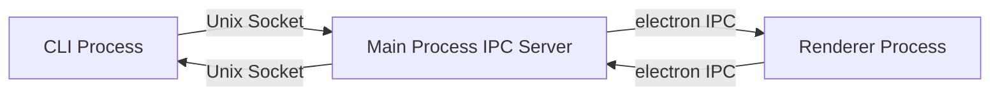
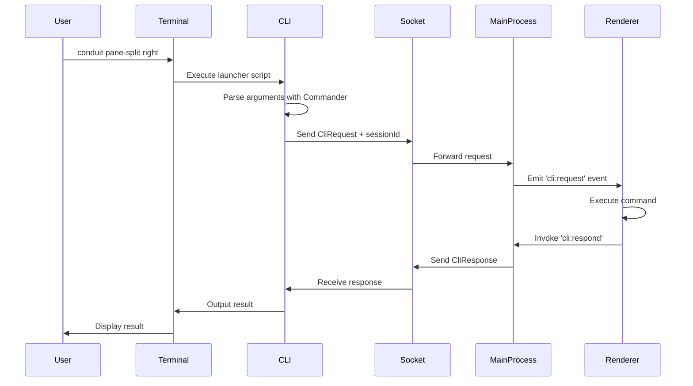
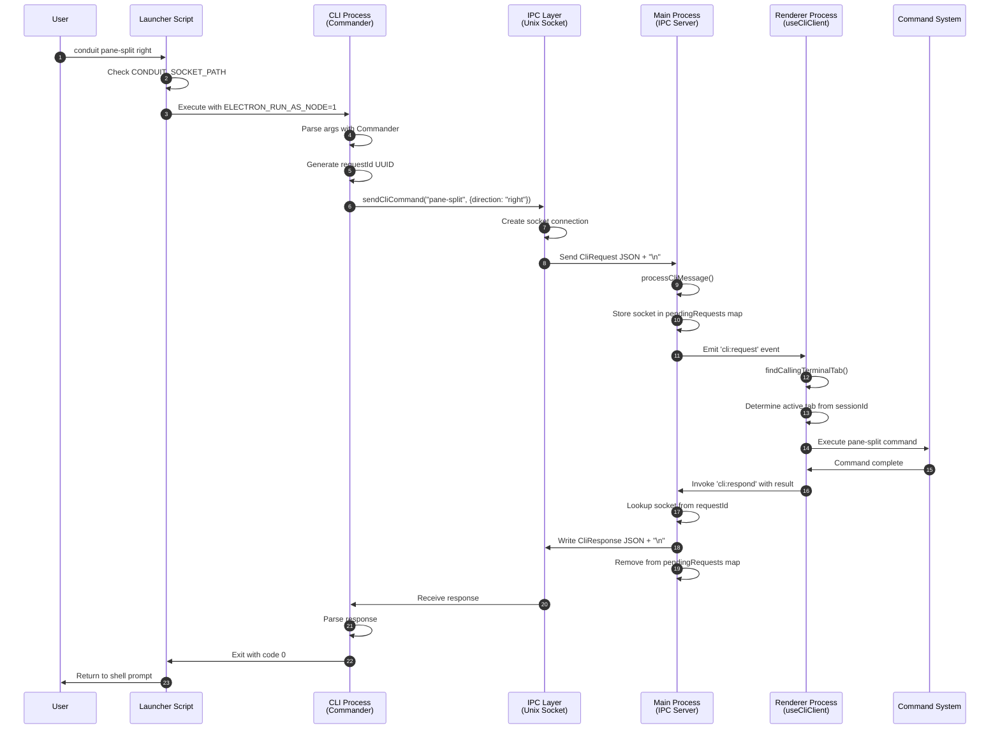

# Conduit CLI Architecture

This document provides a comprehensive overview of how the Conduit CLI is architected, packaged, and integrated with the Conduit application.

## Table of Contents

- [Overview](#overview)
- [Architecture Components](#architecture-components)
- [CLI Packaging and Distribution](#cli-packaging-and-distribution)
- [Communication Flow](#communication-flow)
- [Active Tab Resolution](#active-tab-resolution)
- [Request/Response Lifecycle](#requestresponse-lifecycle)

## Overview

The Conduit CLI enables users to interact with the Conduit application from within terminal sessions. Commands like `conduit editor-open`, `conduit pane-split`, and `conduit pane-list` allow developers to control the IDE programmatically from their shell, enabling powerful automation and workflow integration.

The CLI is built on a multi-process architecture that leverages:

1. **CLI Process** - A Node.js script that parses commands and communicates with the main process
2. **Main Process** - An Electron main process that hosts an IPC server and routes requests
3. **Renderer Process** - The UI process that handles the actual command execution

## Architecture Components

### 1. CLI Entry Point (`src/cli/index.ts`)

The CLI is built using the [Commander.js](https://github.com/tj/commander.js) library and defines all available commands. Key responsibilities include:

- Parsing command-line arguments
- Validating input parameters
- Invoking the IPC communication layer
- Formatting and displaying command results

**Example command definition:**

```typescript
program
  .cliCommand("pane-split", (request, direction, { type }) =>
    request({ direction, paneType: type }),
  )
  .alias("split")
  .description("Split the active pane in the requested direction.")
  .addArgument(
    new Argument("[direction]", "Direction to split the active pane")
      .choices(PANE_SPLIT_TARGETS)
      .default("right"),
  )
  .addOption(
    new Option("-t, --type <paneType>", "Type of pane to open")
      .choices(PANE_SPLIT_TYPES)
      .default("terminal"),
  );
```

### 2. CLI Command Extension (`src/cli/command/`)

The `cliCommand` method is a custom extension to Commander that provides type-safe command handlers. It:

- Extends Commander's Command prototype
- Wraps command callbacks with IPC request handling
- Provides TypeScript type inference for command arguments and results

### 3. IPC Communication Layer (`src/cli/command/ipc.ts`)

This module handles communication between the CLI process and the main process via Unix domain sockets (or named pipes on Windows):

```typescript
export async function sendCliCommand<
  Name extends CliCommand["name"],
  Result = undefined,
>(name: Name, args?: ExtractArgs<Name>) {
  // Build request with unique ID
  const request = JSON.stringify({
    requestId: randomUUID(),
    sessionId,
    command: { name, args },
  } as CliRequest);

  // Connect to IPC server and send request
  const socket = net.createConnection({ path: socketPath }, () =>
    socket.write(`${request}\n`),
  );

  // Wait for response
  const response = await processCliMessage<CliResponse<Result>>(socket, true);

  if (response.error) {
    throw new Error(response.error);
  }

  return response.result;
}
```

Key environment variables:

- `CONDUIT_SOCKET_PATH` - Path to the Unix domain socket for IPC communication
- `CONDUIT_SESSION_ID` - ID of the terminal session making the CLI call

### 4. Main Process IPC Server (`src/ipc/cli/server.ts`)

The main process hosts a Unix domain socket server that:

- Listens for incoming CLI requests
- Forwards requests to the renderer process via Electron IPC
- Maintains a map of pending requests
- Routes responses back to the waiting CLI process



### 5. CLI Initialization (`src/ipc/cli/index.ts`)

During application startup, the main process:

1. Creates a CLI directory in the user data folder
2. Generates platform-specific launcher scripts
3. Starts the IPC server
4. Registers Electron IPC handlers for responses

### 6. Launcher Scripts (`src/ipc/cli/launchers.ts`)

Platform-specific launcher scripts are generated to make the CLI easily accessible:

**Unix/Linux/macOS:**

```bash
#!/bin/sh
if [ -z "$CONDUIT_SOCKET_PATH" ]; then
  echo "CONDUIT_SOCKET_PATH is not set. Please run this command inside a Conduit terminal." >&2
  exit 1
fi

ELECTRON_BIN="/path/to/electron"
CLI_ENTRY="/path/to/cli.js"

export ELECTRON_RUN_AS_NODE=1
exec "$ELECTRON_BIN" "$CLI_ENTRY" "$@"
```

**Windows:**

```batch
@echo off
if "%CONDUIT_SOCKET_PATH%"=="" (
  echo CONDUIT_SOCKET_PATH is not set. Please run this command inside a Conduit terminal.
  exit /b 1
)
set "ELECTRON_BIN=C:\path\to\electron.exe"
set "CLI_ENTRY=C:\path\to\cli.js"
set "ELECTRON_RUN_AS_NODE=1"
"%ELECTRON_BIN%" "%CLI_ENTRY%" %*
exit /b %errorlevel%
```

The launcher scripts:

- Verify the terminal is running inside Conduit (via `CONDUIT_SOCKET_PATH`)
- Set `ELECTRON_RUN_AS_NODE=1` to run Electron as a Node.js process
- Execute the CLI entry point with all provided arguments

### 7. Terminal Environment Setup (`src/features/terminal/main/pty.ts`)

When spawning terminal sessions, Conduit injects specific environment variables:

```typescript
function buildTerminalEnv(sessionId: string): NodeJS.ProcessEnv {
  const env = { ...process.env };
  const { commandName, cliDirectory, socketPath } = getCliState();

  // Add CLI to PATH
  env.PATH = [cliDirectory, ...currentPathSegments].join(path.delimiter);

  // Set Conduit as default editor
  if (useConduitAsEditor) {
    env.VISUAL = commandName;
    env.EDITOR = commandName;
  }

  // Expose IPC details
  env.CONDUIT_SOCKET_PATH = socketPath;
  env.CONDUIT_SESSION_ID = sessionId;

  return env;
}
```

### 8. Renderer Process Handler (`src/renderer/cli/useCliClient.ts`)

The renderer process handles CLI requests by:

- Listening for `cli:request` events from the main process
- Executing the requested command using the application's command system
- Sending responses back to the main process via `cli:respond`

## CLI Packaging and Distribution

### Build Configuration

The CLI is built as a separate entry point by `buildCli` in `build/bun.build.ts`, which bundles `src/cli/index.ts` into `dist/main/cli.js`:

```typescript
export function buildCli({ dev = false }: Options = {}) {
  return run("cli", {
    entrypoints: [path.join(root, "src/cli/index.ts")],
    outdir: mainDir,
    naming: "cli.js",
    target: "node",
    format: "cjs",
    external: ["electron"],
    minify: !dev,
    ...runtimePaths,
  });
}
```

### Electron Forge Integration

The CLI is packaged with the Electron application using Electron Forge. Key packaging details:

1. **ASAR Archive** - The CLI is included in the app's ASAR archive
2. **RunAsNode Fuse** - The `RunAsNode` fuse is enabled to allow Electron to run as a Node.js process:

```typescript
[FuseV1Options.RunAsNode]: true
```

3. **Platform-specific executables** - Launcher scripts are generated for each platform (`.cmd` for Windows, shell scripts for Unix-like systems)

### Distribution

When the application is installed:

1. Launcher scripts are placed in: `{userData}/cli/bin/`
2. The IPC socket is created at: `{userData}/cli/cli.sock` (or a named pipe on Windows)
3. The CLI binary is available at: `{appPath}/dist/main/cli.js`

Users access the CLI via the `conduit` command, which is automatically added to the `PATH` environment variable in terminal sessions.

## Communication Flow

### High-Level Request Flow



### Detailed Message Protocol

#### Request Message (CLI → Main)

```typescript
type CliRequest = {
  requestId: string; // Unique UUID for this request
  sessionId: string; // Terminal session making the request
  command: {
    name: string; // Command name (e.g., "pane-split")
    args?: object; // Command-specific arguments
  };
};
```

**Example:**

```json
{
  "requestId": "a1b2c3d4-e5f6-7890-abcd-ef1234567890",
  "sessionId": "term-abc123",
  "command": {
    "name": "pane-split",
    "args": {
      "direction": "right",
      "paneType": "terminal"
    }
  }
}
```

#### Response Message (Main → CLI)

```typescript
type CliResponse<T = undefined> = {
  requestId: string; // Matches the request ID
  result?: T; // Success result (type varies by command)
  error?: string; // Error message if failed
};
```

**Success example:**

```json
{
  "requestId": "a1b2c3d4-e5f6-7890-abcd-ef1234567890",
  "result": null
}
```

**Error example:**

```json
{
  "requestId": "a1b2c3d4-e5f6-7890-abcd-ef1234567890",
  "error": "Unable to split pane: no active pane found"
}
```

### Message Processing

Messages are processed using a newline-delimited protocol (`src/shared/cli/protocol.ts`):

1. Accumulate incoming data chunks until a newline (`\n`) is encountered
2. Parse the complete message as JSON
3. Validate the message structure
4. Return the parsed object

This ensures reliable message transmission over the socket connection, even when messages are split across multiple network packets.

## Active Tab Resolution

One of the critical challenges in the CLI architecture is determining which tab a CLI command should affect. This is especially important because users can run CLI commands from:

1. **Tab terminals** - Terminal panes within a specific tab layout
2. **Floating terminal** - The quick terminal overlay that isn't tied to a specific tab

### Resolution Strategy

When a CLI command is received, the renderer process determines the target tab using the following algorithm:

```typescript
const findCallingTerminalTab = () => {
  // 1. Search all tabs for a terminal with matching sessionId
  let matchingTab = tabs.find((tab) =>
    Object.values(tab.panes).some(
      (pane) => pane.type === "terminal" && pane.sessionId === sessionId,
    ),
  );

  // 2. If not found in any tab, check if it's the floating terminal
  if (!matchingTab) {
    if (hyperTerminal?.terminalId === sessionId) {
      matchingTab = activeTab; // Use the currently active tab
    }
  }

  return matchingTab;
};
```

### Tab Terminal Behavior

When a CLI command is run from a terminal pane within a tab:

- The command operates on the **tab containing that terminal**
- Other panes in that tab can be accessed (e.g., `pane-list`)
- Split operations create new panes in that tab
- Move operations can relocate the pane within the tab

### Floating Terminal Behavior

When a CLI command is run from the floating quick terminal:

- The command operates on the **currently active tab** (the one visually in focus)
- This allows the floating terminal to control any tab
- The floating terminal itself is not considered when listing panes

### Example Scenarios

#### Scenario 1: List panes from tab terminal

```bash
# Running from terminal in Tab 1
$ conduit pane-list
# Returns: All panes in Tab 1 (excluding the calling terminal)
```

#### Scenario 2: List panes from floating terminal

```bash
# Running from floating terminal, Tab 2 is active
$ conduit pane-list
# Returns: All panes in Tab 2 (floating terminal is not included)
```

#### Scenario 3: Split pane from tab terminal

```bash
# Running from terminal in Tab 1
$ conduit pane-split right --type editor
# Creates: Editor pane to the right within Tab 1
```

#### Scenario 4: Split pane from floating terminal

```bash
# Running from floating terminal, Tab 3 is active
$ conduit pane-split bottom --type browser
# Creates: Browser pane at the bottom of Tab 3
```

### Wildcard Terminal Operations

The `terminal-write` command supports a wildcard (`*`) to target all terminals in the tab:

```typescript
if (args.sessionId === "*") {
  const matchingTab = findCallingTerminalTab();

  // Get all terminal panes in the tab, excluding the caller
  targetSessionIds = Object.values(matchingTab.panes)
    .filter((pane) => pane.type === "terminal" && pane.sessionId !== sessionId)
    .map((pane) => pane.sessionId);
}
```

This enables powerful automation like:

```bash
# Send the same command to all other terminals in the tab
$ conduit terminal-write "*" npm test --newline
```

## Request/Response Lifecycle

### Complete Lifecycle Diagram



### State Management

#### Main Process State

The main process maintains a map of pending requests:

```typescript
const pendingRequests = new Map<string, net.Socket>();

// When request arrives
pendingRequests.set(request.requestId, socket);

// When response is sent
pendingRequests.delete(requestId);
socket.end();
```

This allows multiple concurrent CLI commands to be in-flight simultaneously, with responses routed back to the correct waiting CLI process.

#### Renderer Process State

The renderer process uses React hooks and TanStack Store atoms to access:

- `tabsAtom` - All tab configurations
- `activeTabAtom` - Currently active tab
- `hyperTerminalAtom` - Floating terminal state

This state is used to resolve the target tab and execute commands in the appropriate context.

### Error Handling

Errors can occur at multiple levels:

1. **CLI Level** - Invalid arguments, missing required parameters
2. **IPC Level** - Socket connection failures, invalid JSON
3. **Main Process Level** - Server not running, socket errors
4. **Renderer Level** - Command execution failures

All errors are propagated back through the response chain. Handlers throw errors which are caught by the CLI client wrapper:

```typescript
try {
  const result = await handler(args, context);

  if (!isResponseSuppressed) {
    respondResult(result);
  }
} catch ({ message }) {
  respondError(message);
}
```

The CLI process receives the error and exits with a non-zero status code:

```typescript
if (response.error) {
  throw new Error(response.error);
}
```

### Cleanup and Shutdown

When the application shuts down:

1. Main process closes all pending requests with an error message
2. IPC server stops listening
3. Socket file is removed (Unix-like systems)

```typescript
async function shutdown() {
  // Close pending requests
  for (const [requestId, socket] of pendingRequests) {
    respondWithSocket(socket, {
      error: "Conduit is shutting down.",
    });
    pendingRequests.delete(requestId);
  }

  // Close server
  await new Promise((resolve) => server.close(resolve));

  // Cleanup socket file
  cleanupSocket(socketPath);
}
```

## Available Commands

### Pane Commands

- `pane-list` - List all panes in the active tab
  - `-t, --type <paneType>` - Filter panes by type (all, terminal, browser, editor)
- `pane-split [direction]` - Split the active pane (default: right)
  - `-t, --type <paneType>` - Type of pane to open (terminal, browser, editor)
- `pane-move [direction]` - Move the active pane (default: tab)
- `pane-close` - Close the active pane
  - `-t, --tab` - Close the active tab instead of the pane
- `pane-focus` - Toggle focus mode

### Tab Commands

- `tab-new` - Open a new tab
  - `-t, --title <title>` - Title for the new tab
  - `-c, --command <command>` - Command to run in the new tab
- `tab-duplicate` - Duplicate the active tab
- `tab-lock` - Toggle the locked state of the active tab
- `tab-synchronize` - Toggle the synchronized state of the active tab

### Terminal Commands

- `terminal-read` - Read terminal buffer contents
  - `-p, --pane <paneId>` - The ID of the pane to read
  - `-a, --all` - Read from all terminals in the tab
- `terminal-write <input...>` - Send input to terminal
  - `-p, --pane <paneId>` - The ID of the pane to write to
  - `-a, --all` - Write to all terminals in the tab
  - `-e, --enter` - Simulate pressing enter/return after sending the input
- `notify <message...>` - Display a notification
  - `-p, --persistent` - Don't auto-hide the notification

### Browser Commands

#### Simple Browser Commands

- `browser-capture` - Capture screenshot of browser pane
  - `-p, --pane <paneId>` - The ID of the pane to capture
- `browser-navigate <url>` - Navigate to a URL
  - `-p, --pane <paneId>` - The ID of the pane to navigate
- `browser-back` - Navigate back in history
  - `-p, --pane <paneId>` - The ID of the pane
- `browser-forward` - Navigate forward in history
  - `-p, --pane <paneId>` - The ID of the pane
- `browser-refresh` - Refresh the browser pane
  - `-p, --pane <paneId>` - The ID of the pane to refresh

#### Browser Automation Commands

- `browser-query [selector]` - Query for elements
  - `-p, --pane <paneId>` - The ID of the pane to query
  - `-c, --context <handle>` - Parent element handle
  - `-t, --text <text>` - Filter by text content
  - `-r, --role <role>` - ARIA role to filter by, from the `role` attribute or the element itself (an `<input>` is a `textbox`, an `<a href>` a `link`)
  - `-m, --max-results <count>` - Maximum number of results
  - `--timeout <ms>` - Wait up to this long for a match before returning
  - `--dump-tree` - Return accessibility tree snapshot
- `browser-click <handle>` - Click an element
  - `-p, --pane <paneId>` - The ID of the pane
  - `-b, --button <button>` - Mouse button (left, middle, right)
  - `-c, --clicks <count>` - Number of clicks
  - `--offset-x <x>` - X offset from element
  - `--offset-y <y>` - Y offset from element
- `browser-hover <handle>` - Hover over an element
  - `-p, --pane <paneId>` - The ID of the pane
  - `--offset-x <x>` - X offset from element
  - `--offset-y <y>` - Y offset from element
- `browser-focus <handle>` - Focus an element
  - `-p, --pane <paneId>` - The ID of the pane
- `browser-type <handle> <text>` - Type text into an element
  - `-p, --pane <paneId>` - The ID of the pane
  - `-d, --delay <ms>` - Delay between keystrokes
- `browser-keys <handle> <keys>` - Send keyboard keys
  - `-p, --pane <paneId>` - The ID of the pane
- `browser-scroll <handle>` - Scroll element into view
  - `-p, --pane <paneId>` - The ID of the pane
  - `--x <pixels>` - Horizontal scroll amount
  - `--y <pixels>` - Vertical scroll amount
  - `--smooth` - Use smooth scrolling
- `browser-wait [selector]` - Wait for selector or page state
  - `-p, --pane <paneId>` - The ID of the pane
  - `-s, --state <state>` - Load state (domcontentloaded, networkidle)
  - `--timeout <ms>` - Timeout before failing

### Editor Commands

- `editor-open <path>` - Open file or directory (default command)
  - For commit messages (COMMIT_EDITMSG), the command waits until the editor is closed

## Security Considerations

### Socket Security

- **Unix domain sockets** are only accessible to processes with appropriate file system permissions
- **Named pipes on Windows** use the user's security context
- Socket path includes process ID to prevent conflicts between multiple instances

### Environment Variable Validation

The launcher scripts verify that `CONDUIT_SOCKET_PATH` is set, ensuring commands only run from within Conduit terminals:

```bash
if [ -z "$CONDUIT_SOCKET_PATH" ]; then
  echo "CONDUIT_SOCKET_PATH is not set. Please run this command inside a Conduit terminal." >&2
  exit 1
fi
```

### Session ID Validation

Each CLI request includes the `CONDUIT_SESSION_ID` to identify which terminal is making the request. This prevents cross-session interference and ensures commands operate on the correct tab.
