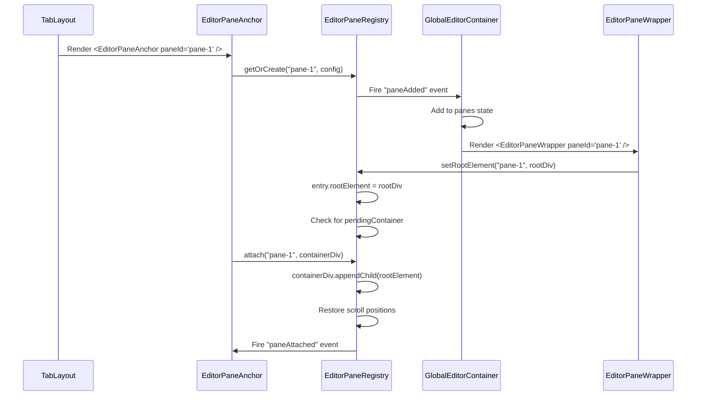
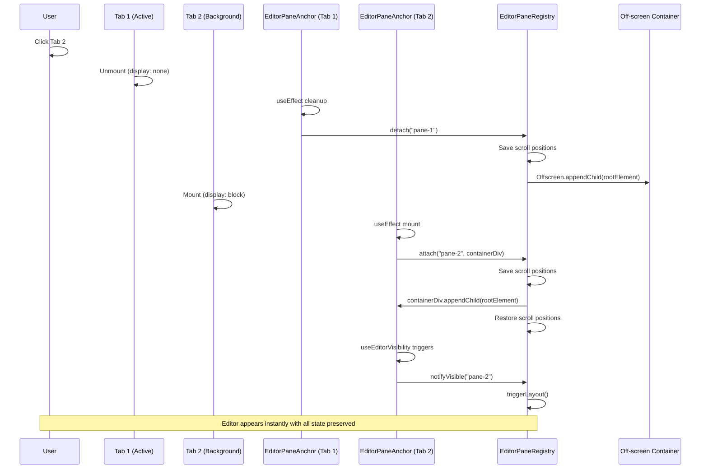
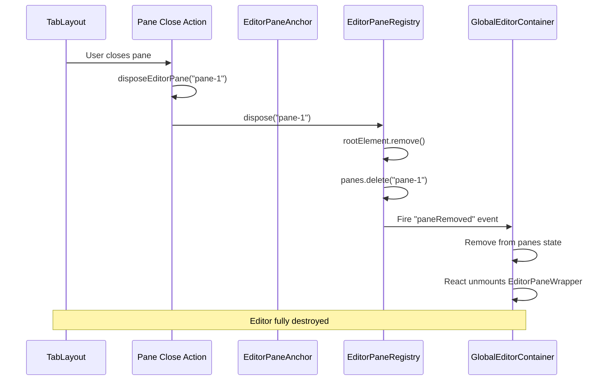

# Conduit Global Panes Architecture

This document provides a comprehensive overview of the global panes architecture, which enables editor panes to persist their state across tab switches, layout changes, and DOM reorganization without losing scroll position, cursor state, or undo history.

## Table of Contents

- [Overview](#overview)
- [The Problem](#the-problem)
- [Comparison with Browser Panes](#comparison-with-browser-panes)
- [Architecture Components](#architecture-components)
- [Data Structures](#data-structures)
- [Lifecycle and Flow](#lifecycle-and-flow)
- [Scroll Persistence System](#scroll-persistence-system)
- [Visibility Detection System](#visibility-detection-system)
- [Why This Design](#why-this-design)
- [Usage Patterns](#usage-patterns)

## Overview

The global panes architecture pattern keeps editor panes "alive" across tab switches and layout changes by rendering them at the application root level and moving their DOM nodes between containers as needed.

This approach is **fundamentally different** from traditional React component patterns where components unmount/remount when their parent changes. Instead, editor instances are:

1. **Rendered once** in a `GlobalEditorContainer` at the app root
2. **Moved as DOM nodes** between visual containers using the DOM API
3. **Never unmounted** during normal tab/layout operations
4. **Tracked globally** via `EditorPaneRegistry` singleton

Key benefits:

- **No Visual Flashing** - Editors move smoothly between tabs without re-rendering
- **State Preservation** - Monaco editor maintains scroll, cursor, undo history, and all internal state
- **Performance** - Avoids expensive React reconciliation and Monaco re-initialization
- **Tab Preview Support** - Editors can be shown in hover previews and overview mode
- **Scroll Persistence** - File tree scroll positions survive DOM moves and tab switches

## The Problem

### Traditional React Pattern Issues

In a traditional React application, when you switch between tabs, the components for the inactive tab unmount and later remount when you switch back. For complex stateful components like Monaco editors, this creates several problems:

#### Problem 1: Monaco Layout with `display: none`

Monaco Editor's layout system breaks when its container has `display: none`:

```typescript
// Traditional pattern - BROKEN
{activeTab === 'tab1' ? (
  <EditorPane pane={config} />  // Mounted
) : null}                        // Unmounted when switching tabs
```

When the tab switches back:

1. Component remounts
2. Monaco initializes with container size 0×0 (because parent might still be transitioning)
3. Content is invisible or incorrectly positioned
4. Calling `editor.layout()` doesn't fix it if container isn't properly sized yet

#### Problem 2: State Loss

Every time a tab switches, the editor loses:

- **Scroll position** - File tree and editor scroll back to top
- **Cursor position** - User's place in the file is lost
- **Selection state** - Active text selections disappear
- **Undo/redo history** - All editing history is cleared
- **Folded code regions** - Collapsed sections expand
- **Find/replace state** - Search boxes and their state reset

#### Problem 3: Visual Flashing

Remounting creates visible artifacts:

1. Old editor fades out
2. Brief flash of empty space
3. New editor fades in
4. Content "jumps" as it loads and positions itself

This makes tab switching feel sluggish and unprofessional.

#### Problem 4: Performance

Remounting Monaco is expensive:

- DOM creation (~50-100ms)
- Monaco initialization (~100-200ms)
- Syntax highlighting (~50-150ms depending on file size)
- Total: **200-450ms** of unnecessary work on every tab switch

### The Global Panes Solution

Instead of unmounting/remounting, we:

1. **Render once** - All editor instances render in `GlobalEditorContainer` at app root
2. **Move, don't unmount** - Use DOM APIs to physically move editor DOM nodes between containers
3. **Track globally** - `EditorPaneRegistry` singleton coordinates all pane movements
4. **Preserve state** - Editors stay mounted, preserving all internal state

Result:

- ✅ No visual flashing
- ✅ Perfect state preservation
- ✅ Instant tab switching
- ✅ Works with previews and overview mode

## Comparison with Browser Panes

The global panes architecture for **editor panes** is fundamentally different from the approach used for **browser panes**, even though both involve rendering content outside the normal React component tree.

### Browser Panes: Outside React Entirely

Browser panes use Electron's `<webview>` tag, which is a **native Electron element** that embeds an entire Chromium browser instance. These are created and managed completely outside React's control:

```typescript
// Browser panes create webview elements with DOM APIs
webview = document.createElement("webview") as WebviewTag;
webview.id = paneId;
webview.style.position = "absolute";
document.body.appendChild(webview); // Attached to body, not React tree
```

The webview is positioned absolutely and synced with an anchor element using a continuous `requestAnimationFrame` loop:

```typescript
const updatePosition = () => {
  const rect = anchor.getBoundingClientRect();
  webview.style.left = `${rect.left}px`;
  webview.style.top = `${rect.top}px`;
  webview.style.width = `${rect.width}px`;
  webview.style.height = `${rect.height}px`;

  if (isInPreview) {
    requestAnimationFrame(updatePosition); // Continuous sync
  }
};
```

**Why this works for browser panes:**

- Webviews are **native Electron elements**, not React components
- They have no React state, props, or lifecycle
- Position and size can be set via CSS properties
- Completely isolated from the main renderer process
- No need for React to manage their lifecycle

### Editor Panes: Must Stay in React's Control

Editor panes, by contrast, **must remain within React's control** because they:

1. **Have React state and props** - Monaco editor configuration, file content, callbacks
2. **Receive callbacks from parent** - `onFileChange`, `onCwdChange`, `onSave`, etc.
3. **Subscribe to Redux store** - Need access to application state
4. **Use React hooks** - `useFileSystemV2`, `useGitV2`, and other custom hooks
5. **Render child React components** - File tree, branch selector, change review pane

If we tried the browser pane approach with editors, we'd lose:

- ❌ All React props and callbacks
- ❌ Redux store access
- ❌ Hook functionality
- ❌ Child component rendering
- ❌ Event handler binding

### The Hybrid Solution: Global Container Pattern

The global container pattern keeps editors **inside React** while still enabling physical DOM movement:

1. **Render in React** - `GlobalEditorContainer` renders all editors as React components
2. **Portal to app root** - Uses `createPortal()` to render outside normal hierarchy
3. **Move DOM nodes** - Uses `appendChild()` to physically move rendered DOM between containers
4. **Stay mounted** - React components never unmount during normal operations

This gives us:

- ✅ Full React lifecycle and features
- ✅ Props, state, and callbacks work normally
- ✅ Hooks and context work as expected
- ✅ Physical DOM movement for instant tab switching
- ✅ Perfect state preservation

**Key insight:** Browser panes don't need React, so they can live entirely outside it. Editor panes **require** React, so we keep them inside React's tree while moving their physical DOM representation.

## Architecture Components

### 1. GlobalEditorContainer (`src/renderer/components/panes/editor-v2/components/GlobalEditorContainer.tsx`)

The global container renders all editor instances at the app root level.

**Key responsibilities:**

- Renders all `EditorPaneV2` instances in a portal to `document.body`
- Subscribes to `EditorPaneRegistry` events to add/remove panes
- Provides `EditorPaneWrapper` components that register root elements with the registry

**Core pattern:**

1. Maintains state array of all panes
2. Subscribes to `EditorPaneRegistry` events (`paneAdded`, `paneRemoved`)
3. Renders all panes via `createPortal()` to `document.body`
4. Each pane wrapped in `EditorPaneWrapper` which handles root element registration

The container itself is **invisible** - it's positioned off-screen with zero size. The actual visual positioning is handled by the registry's `attach()` method.

### 2. EditorPaneWrapper (Internal Component)

Wraps each `EditorPaneV2` instance and connects it to the registry.

**Core pattern:**

1. Creates a stable root `<div>` via `useRef`
2. On mount: registers root element with registry via `setRootElement()`
3. Sets up `triggerLayout` callback for Monaco layout updates
4. On unmount: unregisters root element
5. Renders `<EditorPaneV2>` inside the root div

This provides the movable DOM node that can be attached/detached without remounting the React component.

### 3. EditorPaneAnchor (`src/renderer/components/panes/editor-v2/EditorPaneAnchor.tsx`)

Lightweight "anchor" components that mark where editors should appear in the layout.

**Core lifecycle:**

1. On mount:
   - Creates or updates pane entry via `registry.getOrCreate()`
   - Calls `registry.attach()` to move editor DOM into container
   - Sets up visibility tracking via `useEditorVisibility`

2. On unmount:
   - Calls `registry.detach()` to move editor off-screen (doesn't destroy)

3. Visibility changes:
   - `onVisible` → `registry.notifyVisible()` → Monaco layout triggered
   - `onHidden` → `registry.notifyHidden()`

**Key insight:** The anchor is just an empty `<div>` marker. The registry moves the actual editor DOM into it via `appendChild()`.

### 4. EditorPaneRegistry (`src/renderer/components/panes/editor-v2/registry/EditorPaneRegistry.ts`)

Singleton registry that coordinates all editor pane lifecycle operations.

**Core responsibilities:**

- Maintains `Map<paneId, EditorPaneEntry>` tracking all panes
- Manages DOM attachment/detachment via `appendChild()`
- Tracks visibility state and triggers Monaco layouts
- Manages scroll container registration and restoration
- Fires events for pane lifecycle changes

**Critical methods:**

**`getOrCreate(paneId, config)`** - Creates new pane entry, fires `paneAdded` event

**`attach(paneId, container)`** - The critical DOM move operation:

1. Saves all scroll positions before move
2. Calls `container.appendChild(entry.rootElement)` - **physical DOM move**
3. Restores scroll positions in `requestAnimationFrame`
4. Fires `paneAttached` event

**`detach(paneId)`** - Moves editor to off-screen container:

1. Saves scroll positions
2. Moves to `getOffscreenContainer()` - keeps mounted but invisible
3. Fires `paneDetached` event

**`dispose(paneId)`** - Fully removes pane:

1. Removes from DOM via `rootElement.remove()`
2. Deletes from registry map
3. Fires `paneRemoved` event

**Key pattern:** Using `appendChild()` on an element that's already in the DOM **moves** it without destroying state. This is the core of the entire architecture.

### 5. Scroll Persistence Hook (`src/renderer/components/panes/editor-v2/hooks/useScrollPersistence.ts`)

Custom hook that registers scroll containers with the registry and tracks their scroll positions in real-time.

**Core pattern:**

Returns a **callback ref** that:

1. On element mount:
   - Registers with `registry.registerScrollContainer()`
   - Restores saved `scrollTop` position
   - Attaches throttled scroll listener (100ms via RAF)
   - Listener calls `registry.updateScrollPosition()` on every scroll

2. On element unmount:
   - Unregisters from registry
   - Saved position **preserved** for next mount

**Throttling:** Uses `requestAnimationFrame` + timestamp check to limit updates to 100ms intervals, preventing excessive registry writes during fast scrolling.

**Usage:** `const scrollRef = useScrollPersistence(paneId, "fileTree")` and attach to any scrollable `<div ref={scrollRef}>`.

### 6. Visibility Detection Hook (`src/renderer/components/panes/editor-v2/hooks/useEditorVisibility.ts`)

Custom hook that detects when an editor container becomes visible or hidden, triggering Monaco layout updates.

**Three-observer pattern:**

1. **IntersectionObserver** (threshold: 0.01)
   - Detects viewport visibility
   - Catches: scrolling, tab switching, window resizing

2. **MutationObserver** (watches: `style`, `class`, `hidden`)
   - Observes element **and all ancestors**
   - Catches: `display: none` toggles, CSS class changes
   - Why ancestors? Parent containers often control visibility

3. **ResizeObserver**
   - Catches: pane resizing, layout changes, collapsed panes

**Visibility check logic:**

- Element has non-zero size
- Not `display: none` or `visibility: hidden`
- No ancestor is hidden
- Element intersects viewport

**Debouncing:** Callbacks debounced 16ms (one frame) to prevent excessive layout calls during rapid changes like CSS transitions.

## Data Structures

### EditorPaneEntry

The core registry entry that tracks each editor pane:

```typescript
interface EditorPaneEntry {
  /** Unique identifier (matches pane.id) */
  paneId: string;

  /** Current configuration/props */
  config: EditorPaneConfig;

  /** The root DOM element (set by EditorPaneWrapper) */
  rootElement: HTMLDivElement | null;

  /** The container the editor is attached to (null if off-screen) */
  currentContainer: HTMLElement | null;

  /** Container waiting for rootElement (handles race condition) */
  pendingContainer: HTMLElement | null;

  /** Whether editor is currently visible */
  isVisible: boolean;

  /** Creation timestamp */
  createdAt: number;

  /** Last accessed timestamp */
  lastUsed: number;

  /** Callback to trigger Monaco layout */
  triggerLayout?: () => void;

  /** Registered scroll containers for this pane */
  scrollContainers: Map<string, ScrollContainerEntry>;
}
```

### ScrollContainerEntry

Tracks a scrollable element and its saved position:

```typescript
interface ScrollContainerEntry {
  /** The scroll container element (null when unregistered) */
  element: HTMLElement | null;

  /** Saved scroll position (preserved across DOM moves) */
  savedScrollTop: number;
}
```

### EditorPaneConfig

Configuration passed to EditorPaneV2:

```typescript
interface EditorPaneConfig {
  /** The pane configuration (cwd, filePath, etc.) */
  pane: EditorPane;

  /** Callback when file changes */
  onFileChange?: (fileData: FileChangeData) => void;

  /** Callback when file selection cleared */
  onClearFile?: () => void;

  /** Callback when working directory changes */
  onCwdChange?: (cwd: string) => void;

  /** Callback when file opened from tree */
  onFileOpen?: (node: FileNode) => void;

  /** Callback when tree mode changes */
  onTreeModeChange?: (mode: "all" | "changes") => void;

  /** Callback after successful save */
  onSave?: () => void;
}
```

## Lifecycle and Flow

### Pane Creation Flow



### Tab Switch Flow



### Pane Disposal Flow



## Scroll Persistence System

### Problem: Scroll Positions Lost During DOM Moves

When an editor DOM node is moved between containers (e.g., during tab switch), any scrollable elements inside it lose their scroll positions. This happens because:

1. Browser resets scroll positions when elements are detached from DOM
2. React doesn't track scroll state across parent changes
3. Monaco's internal scroll state is tied to the DOM structure

### Solution: Registry-Tracked Scroll Containers

The registry maintains `Map<scrollId, ScrollContainerEntry>` for each pane. Each entry tracks:

- `element` - The current DOM element (or null if unmounted)
- `savedScrollTop` - The last known scroll position

**`registerScrollContainer()`** - Stores element reference and restores `savedScrollTop` immediately

**`updateScrollPosition()`** - Updates `savedScrollTop` (called on every scroll event, throttled by hook)

**`saveScrollPositions()`** - Reads current `scrollTop` from all registered elements before DOM move

**`restoreScrollPositions()`** - Applies saved `scrollTop` to all registered elements after DOM move

### Scroll Persistence Lifecycle

1. **Registration** - Element registers with registry, saved position restored immediately
2. **Tracking** - Scroll listener updates registry (throttled 100ms via RAF)
3. **DOM Move** - Registry saves → DOM appendChild → Registry restores (next frame)
4. **Unregistration** - Element unregistered, but saved position preserved

**Critical timing pattern:**

```typescript
// BEFORE move: save all scroll positions
this.saveScrollPositions(paneId);

// Physical DOM move
container.appendChild(entry.rootElement);

// AFTER move: restore in next frame (DOM needs to settle)
requestAnimationFrame(() => {
  this.restoreScrollPositions(paneId);
});
```

The RAF delay is essential - restoring immediately doesn't work because the browser needs one frame to recalculate layout after the DOM move.

## Visibility Detection System

### Problem: Monaco Layout Breaks When Container Is Hidden

Monaco Editor's layout system requires the container to be visible when `editor.layout()` is called. If called while `display: none` or off-screen, the editor calculates size as 0×0 and breaks visually.

### Solution: Multi-Mechanism Visibility Detection

`useEditorVisibility` uses three complementary detection mechanisms:

#### Why Three Observers?

Each observer catches different visibility change scenarios:

**IntersectionObserver** - Viewport changes (scrolling, tab switch, window resize)

**MutationObserver** - CSS changes on element or ancestors (`display`, `visibility`, class toggles)

- Observes **all ancestors** because parents often control visibility
- Uses RAF to batch multiple rapid changes

**ResizeObserver** - Size changes (drag handles, pane collapse/expand, transitions)

### Visibility Check Logic

The `checkVisibility()` function runs four checks:

1. Element has non-zero size (getBoundingClientRect)
2. Element not `display: none` or `visibility: hidden`
3. **No ancestor is hidden** (walks up parent chain checking computed styles)
4. Element intersects viewport bounds

All checks must pass for element to be considered visible. When visibility state changes, `onVisible` or `onHidden` callbacks fire (debounced 16ms).

## Why This Design

### Alternative Approaches Considered

#### Alternative 1: Keep Components Mounted with `display: none`

Render all tabs simultaneously but hide inactive ones with CSS.

**Problems:**

- ❌ Monaco layout breaks with `display: none`
- ❌ All editors render on initial load (slow)
- ❌ Memory scales with tab count
- ❌ Doesn't work with tab previews

#### Alternative 2: Remount with State Serialization

Serialize editor state on unmount, restore on remount.

**Problems:**

- ❌ Monaco has 50+ state properties to serialize
- ❌ Some state is internal/private
- ❌ Imperfect restoration (race conditions, timing)
- ❌ Visual flashing during remount
- ❌ Expensive: serialize + unmount + mount + deserialize

#### Alternative 3: Portal Switching

Use React portals to move components between containers.

**Problems:**

- ❌ React still reconciles on every switch
- ❌ Portals don't preserve DOM nodes (React recreates)
- ❌ Scroll positions lost
- ❌ Doesn't avoid Monaco layout issue

### Why Global Container + DOM Moves Works Best

The global container pattern solves all these issues:

✅ **No Reconciliation** - Editors render once, React never reconciles them during tab switches

✅ **Perfect State Preservation** - DOM nodes stay intact, all browser and Monaco state preserved

✅ **No Layout Issues** - Editors are never hidden via `display: none`, always attached to a visible container or moved off-screen

✅ **Scroll Persistence** - Registry tracks scroll positions across moves

✅ **Performance** - Tab switch is just a DOM `appendChild()` call (~1ms)

✅ **Preview Support** - Same editor can appear in multiple places (preview, active tab, overview)

✅ **Memory Efficient** - Only renders editors that actually exist, not all possible editors

### Trade-offs

**Benefits:**

- Instant tab switching
- Perfect state preservation
- No visual artifacts
- Works with previews and overview mode
- Minimal performance overhead

**Costs:**

- Increased complexity (registry, lifecycle management)
- More code to maintain (hooks, registry, anchor components)
- Harder to debug (DOM manipulation outside React)
- Requires careful lifecycle management

**Verdict:** The complexity is justified by the dramatic UX improvement and performance gains.

## Usage Patterns

### Basic Usage: Adding an Editor Pane

Replace direct `<EditorPaneV2>` renders with `<EditorPaneAnchor>`:

- Pass `paneId`, `pane`, and callback props
- Anchor handles all registry interactions
- Editor appears automatically when mounted

### Preview Mode: Tab Hover

Use `isInPreview={true}` prop to add interaction overlay (prevents clicks/focus).

### Adding Scroll Persistence

Call `useScrollPersistence(paneId, scrollId)` and attach returned ref to scrollable container. Hook handles all registration/restoration automatically.

### Disposing Panes

Call `disposeEditorPane(paneId)` to fully remove from registry and DOM. Use when closing tabs permanently.

### Manual Layout Triggers

Call `registry.notifyVisible(paneId)` to force visibility check and layout update. Useful after programmatic size changes.

---

## Summary

The global panes architecture represents a sophisticated solution to the challenge of maintaining rich editor state across dynamic layout changes. By moving editors as DOM nodes rather than unmounting/remounting React components, we achieve:

- **Instant tab switching** - No visual flashing or re-initialization
- **Perfect state preservation** - Scroll, cursor, undo history all maintained
- **Robust visibility detection** - Multiple mechanisms ensure Monaco always layouts correctly
- **Scroll persistence** - File trees remember their positions across moves
- **Preview support** - Editors can appear in multiple contexts simultaneously

While the implementation is more complex than traditional React patterns, the dramatic improvement in user experience and performance makes it a worthwhile architectural investment.
