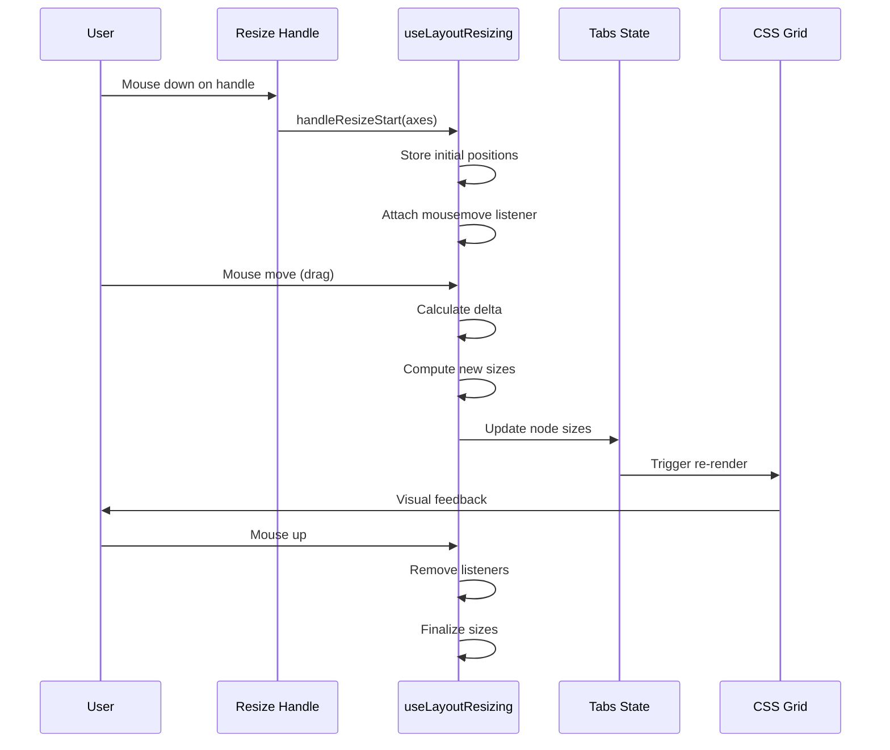
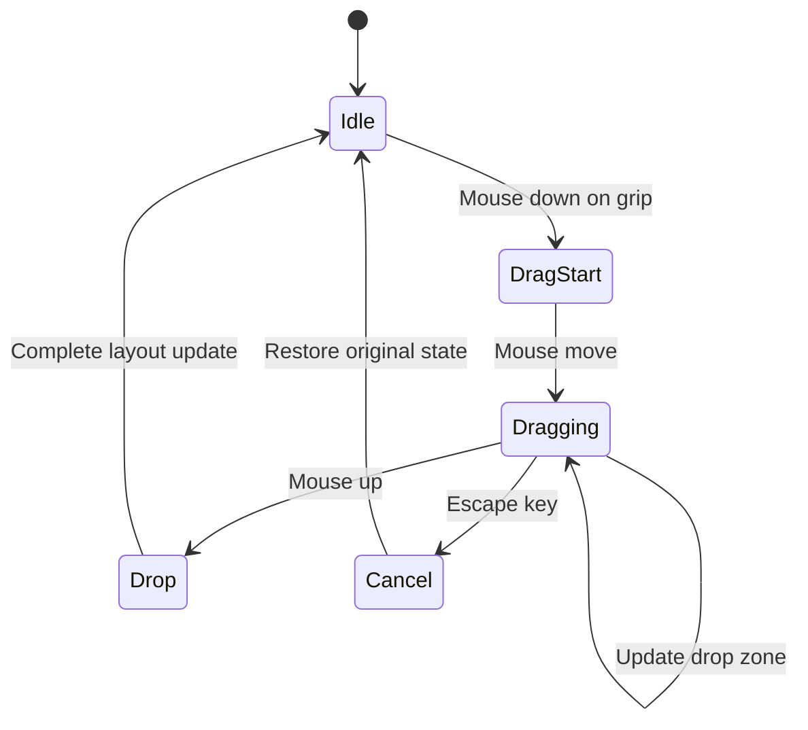
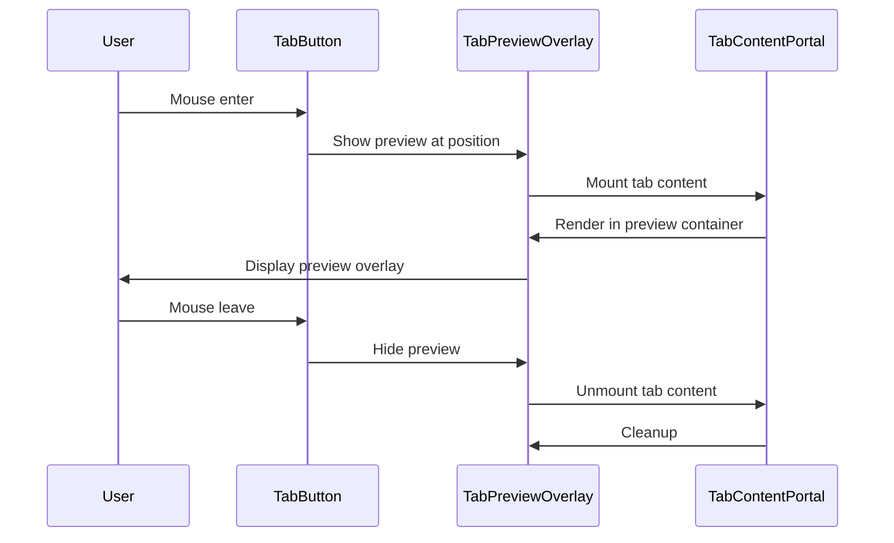
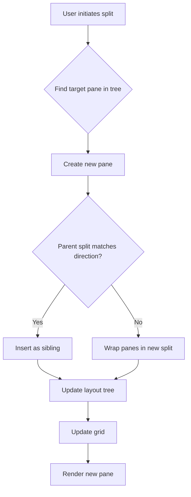
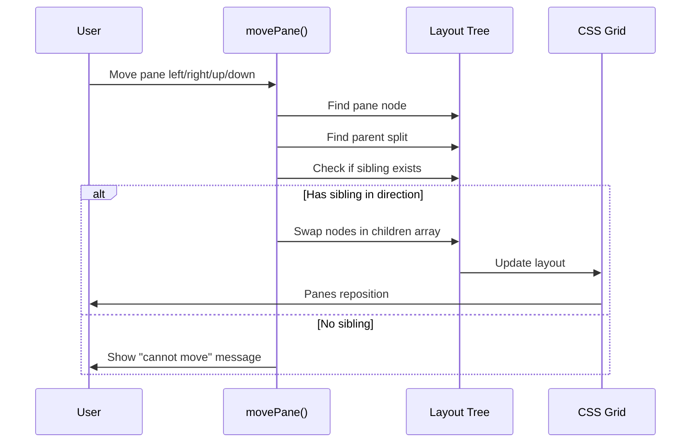
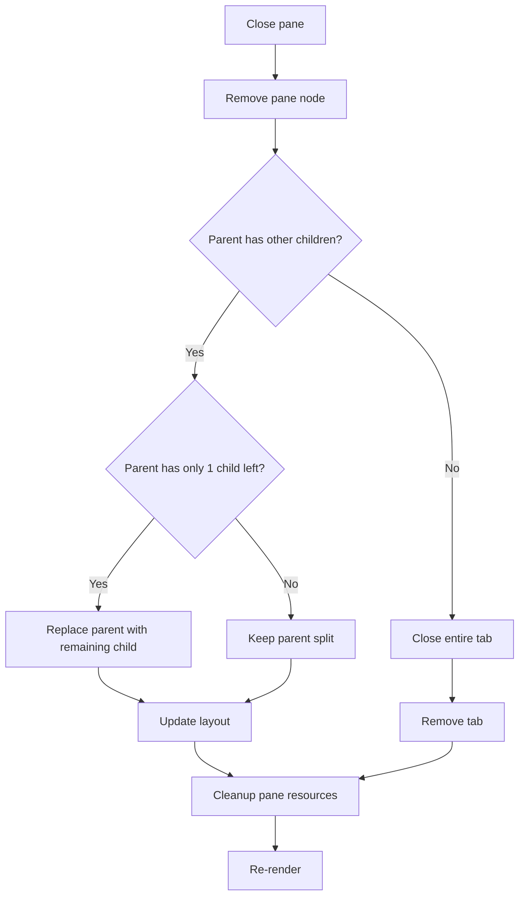

# Conduit Tab Layout System Architecture

This document provides a comprehensive overview of how the Conduit tab layout system is architected, including the grid layout system, pane resizing with intersection handles, focus mode, design mode, drag and drop, preview tab rendering, and collapsed panes.

## Table of Contents

- [Overview](#overview)
- [Architecture Components](#architecture-components)
- [Layout Data Structures](#layout-data-structures)
- [Grid Layout System](#grid-layout-system)
- [Pane Resizing](#pane-resizing)
- [Application Modes](#application-modes)
- [Drag and Drop](#drag-and-drop)
- [Tab Preview System](#tab-preview-system)
- [Collapsed Panes](#collapsed-panes)
- [Layout Operations](#layout-operations)

## Overview

The Conduit tab layout system provides a flexible, multi-pane interface where users can organize terminal, editor, and browser panes within tabs. The system is built on a tree-based layout structure that supports arbitrary nesting and dynamic reorganization through drag-and-drop, resizing, and programmatic operations.

Key features include:

1. **Tree-Based Layout** - Hierarchical layout structure supporting arbitrary split arrangements
2. **CSS Grid Rendering** - Dynamic grid-based rendering with smooth resizing
3. **Multiple Application Modes** - Normal, focus, design, and overview modes for different workflows
4. **Interactive Resizing** - Drag handles with intersection detection for complex layouts
5. **Drag and Drop** - Intuitive pane reorganization within and across tabs
6. **Tab Previews** - Hover preview and overview mode for quick tab navigation
7. **Collapsed Panes** - Minimize panes to reclaim screen space while maintaining layout structure

## Architecture Components

### 1. Core Layout Component (`src/renderer/components/layout/normal/TabLayout.tsx`)

The `TabLayout` component is the main orchestrator that:

- Renders all tabs and their pane arrangements
- Manages resize handles and intersection handles
- Coordinates drag and drop operations
- Switches between application modes
- Handles pane activation and focus
- Renders mode-specific overlays (focus indicators, design mode controls)

**Key responsibilities:**

```typescript
interface TabLayoutProps {
  handleContextMenu: (event, tabId, paneId?) => void;
  handleResizeStart: (e, payload) => void;
  resizingNode: string | null;
  handleBrowserUpdate: (tabId, paneId, updates) => void;
  handleEditorUpdate: (tabId, paneId, updates) => void;
  onOpenPaneActions?: () => void;
}
```

### 2. Layout Utilities (`src/renderer/utils/layout.ts`)

Core utilities for layout tree manipulation:

- `walkLayout()` - Depth-first traversal of layout trees
- `findPaneNodeByPaneId()` - Locate pane nodes by ID
- `countPanesInLayout()` - Count total panes in a layout
- `layoutContainsPaneId()` - Check if a pane exists in a subtree
- `getPaneDirectionConfig()` - Map directions to axis configurations

### 3. Layout Actions (`src/renderer/store/actions/pane.ts`)

State management actions for layout operations:

- `splitPane()` - Split a pane in a direction
- `movePane()` - Move a pane to adjacent position
- `closePane()` - Remove a pane and clean up layout
- `activatePane()` - Set active pane for a tab
- `setPaneCollapsed()` - Toggle pane collapsed state
- `detachPane()` - Remove pane for drag and drop

### 4. Resize System (`src/hooks/useLayoutResizing.ts`)

Manages interactive pane resizing with support for:

- Primary axis resizing (single boundary)
- Multi-axis resizing (intersection handles)
- Real-time size updates during drag
- Mouse tracking and boundary calculations

### 5. Drag and Drop (`src/renderer/components/layout/normal/usePaneDragDrop.tsx`)

Implements pane reorganization through drag and drop:

- Drop zone detection (top, bottom, left, right)
- Visual feedback during drag operations
- Pane detachment and reattachment
- Cross-tab pane movement
- Focus mode drag-to-enter

## Layout Data Structures

### Layout Tree Types

The layout system uses a tree structure where each node is either a pane (leaf) or a split (branch):

```typescript
// Leaf node - represents an actual pane
type LayoutPaneNode = {
  type: "pane";
  id: string; // Unique node ID
  paneId: string; // References pane in tab.panes
  size?: number; // Flex size (relative)
  collapsed?: boolean; // Whether pane is minimized
};

// Branch node - represents a split container
type LayoutSplitNode = {
  type: "split";
  id: string; // Unique node ID
  direction: "row" | "column"; // Split axis
  children: LayoutNode[]; // Child nodes
  size?: number; // Flex size (relative)
};

// Union type for all layout nodes
type LayoutNode = LayoutPaneNode | LayoutSplitNode;
```

### Tab Structure

Tabs contain panes and their layout arrangement:

```typescript
type Tab = {
  id: string;
  panes: Record<string, Pane>; // Pane data by ID
  layout: LayoutNode; // Layout tree
  activePaneId: string; // Currently focused pane
  name?: string; // Optional tab name
  locked?: boolean; // Prevents modification
  synchronized?: boolean; // Git sync status
};
```

### Pane Types

Three types of panes are supported:

```typescript
type TerminalPane = {
  type: "terminal";
  id: string;
  sessionId: string; // PTY session ID
  cwd: string | null; // Working directory
  title: string; // Current process
  vmId?: string; // Cloud VM ID (connection details managed by backend)
  agentSessionId?: string; // Agent context
};

type EditorPane = {
  type: "editor";
  id: string;
  cwd: string; // Base directory
  filePath?: string; // Currently open file
  treeMode?: "all" | "changes"; // File tree filter
  vmId?: string; // Cloud VM ID (connection details managed by backend)
  agentSessionId?: string; // Agent context
};

type BrowserPane = {
  type: "browser";
  id: string;
  url: string; // Current URL
  title?: string; // Page title
  devToolsFor?: string; // Parent pane if devtools
};
```

## Grid Layout System

### CSS Grid Generation

The layout system uses CSS Grid to position panes. Each split node becomes a grid container with its children as grid items.

**Grid template generation:**

```typescript
function buildGridTemplateStyles(
  children: LayoutNode[],
  direction: SplitDirection,
  activePaneId?: string,
  isInFocusMode?: boolean,
): React.CSSProperties {
  // In focus mode, only the active pane gets space
  if (isInFocusMode && activePaneId) {
    const templateValue = buildTemplateString(
      children.map((child) =>
        layoutContainsPaneId(child, activePaneId) ? 1 : 0,
      ),
    );
    return direction === "row"
      ? { gridTemplateColumns: templateValue }
      : { gridTemplateRows: templateValue };
  }

  // Normal mode: allocate space based on size property
  const templateValue = buildTemplateString(
    children.map((child) => {
      if (child.type === "pane" && child.collapsed) return "collapsed"; // Fixed 25px
      return child.size ?? 1; // Flex proportion
    }),
  );

  return direction === "row"
    ? { gridTemplateColumns: templateValue }
    : { gridTemplateRows: templateValue };
}
```

**Template string format:**

- Collapsed panes: `25px` (fixed)
- Regular panes: `minmax(0, Nfr)` where N is the size property
- The `minmax(0, ...)` ensures panes can shrink below their content size

### Visual Gaps

Grid gaps create visual separation between panes:

```typescript
// Gaps reveal the background overlay underneath
const gridGapClass =
  applicationMode === "focus" || applicationMode === "design" || isInPreview
    ? "gap-0" // No gaps in special modes
    : "gap-[1px]"; // 1px gap in normal mode
```

### Layout Example

```
Tab Layout Tree:
  Split(row)
    ├─ Split(column)
    │   ├─ Pane(terminal-1) [size: 1]
    │   └─ Pane(terminal-2) [size: 1]
    └─ Pane(editor-1) [size: 2]

Rendered Grid:
┌────────────┬─────────────────────┐
│ Terminal 1 │                     │
├────────────┤     Editor 1        │
│ Terminal 2 │                     │
└────────────┴─────────────────────┘
```

## Pane Resizing

### Resize Handle System

The resize system provides interactive handles for adjusting pane sizes.

#### Primary Resize Handles

Every boundary between sibling panes has a primary resize handle:

```typescript
type LayoutResizeAxis = {
  containerNodeId: string; // Parent split node
  direction: SplitDirection; // Row or column
  leadingNodeId: string; // Left/top node
  trailingNodeId: string; // Right/bottom node
  leadingSize: number; // Current leading size
  trailingSize: number; // Current trailing size
};
```

**ResizeHandle component** (`src/renderer/components/layout/normal/ResizeHandle.tsx`):

- Positioned at split boundaries
- 1px wide/tall, but with larger hit area
- Cursor changes to indicate drag direction
- Highlights on hover and during resize

```typescript
<ResizeHandle
  direction={node.direction}
  highlightClass={isHighlighted ? "bg-accent/80" : "bg-transparent"}
  onMouseDown={(e) => handleResizeStart(e, {
    tabId: tab.id,
    activeHandleId: child.id,
    axes: [primaryAxis],
  })}
/>
```

#### Intersection Handles

When perpendicular splits align, intersection handles allow resizing multiple boundaries simultaneously.

**Intersection detection algorithm:**

```typescript
function computeIntersectionHandles(
  previousSibling: LayoutNode,
  currChild: LayoutNode,
  parentDirection: SplitDirection,
): IntersectionHandleConfig[] {
  const perpendicularDirection = parentDirection === "row" ? "column" : "row";

  // Collect boundaries from both siblings if they split perpendicular
  const prevBoundaries =
    previousSibling.type === "split" &&
    previousSibling.direction === perpendicularDirection
      ? collectBoundaries(previousSibling)
      : [];

  const currBoundaries =
    currChild.type === "split" && currChild.direction === perpendicularDirection
      ? collectBoundaries(currChild)
      : [];

  // Merge boundaries that are close (within 8% tolerance)
  const seeds = [];
  for (const boundary of [...prevBoundaries, ...currBoundaries]) {
    const existing = seeds.find(
      (seed) => Math.abs(seed.position - boundary.position) <= 0.08,
    );

    if (existing) {
      // Average positions and add axis
      existing.position = (existing.position + boundary.position) / 2;
      existing.axes.push(createAxis(boundary));
    } else {
      // Create new seed
      seeds.push({
        position: boundary.position,
        axes: [createAxis(boundary)],
      });
    }
  }

  return seeds;
}
```

**IntersectionHandles component** (`src/renderer/components/layout/normal/IntersectionHandles.tsx`):

- 4x4px hit area at intersection points
- Diagonal resize cursor (`nwse-resize` or `nesw-resize`)
- Resizes multiple axes simultaneously
- Positioned absolutely at calculated positions

```
Example Intersection:

  ┌─────┬─────┐
  │  A  │  B  │
  ├─────○─────┤  ← Intersection handle (○)
  │  C  │  D  │     Resizes A↔B and C↔D together
  └─────┴─────┘
```

### Resize Operation Flow



### Size Calculation

During resize, sizes are calculated proportionally:

```typescript
function updateSizes(
  axes: LayoutResizeAxis[],
  delta: number,
  totalSize: number,
) {
  for (const axis of axes) {
    const pixelDelta = delta; // Mouse movement in pixels
    const totalFlex = axis.leadingSize + axis.trailingSize;
    const flexDelta = (pixelDelta / totalSize) * totalFlex;

    // Clamp to prevent negative sizes
    const newLeadingSize = Math.max(0.1, axis.leadingSize + flexDelta);
    const newTrailingSize = Math.max(0.1, axis.trailingSize - flexDelta);

    // Update nodes with new sizes
    updateNode(axis.leadingNodeId, newLeadingSize);
    updateNode(axis.trailingNodeId, newTrailingSize);
  }
}
```

## Application Modes

Conduit has four distinct application modes that affect layout rendering and behavior:

### Normal Mode

The default mode for regular interaction.

**Characteristics:**

- Full layout rendering with all panes visible
- 1px gaps between panes (grid gap)
- Resize handles visible on hover
- Pane activation via click
- Context menus available

**Grid rendering:**

```css
.split-container {
  display: grid;
  gap: 1px; /* Visual separation */
}
```

### Focus Mode

Immersive mode showing only the active pane fullscreen.

**Characteristics:**

- Only active pane allocated grid space (others get 0)
- No grid gaps or resize handles
- Focus indicator overlay in bottom-right corner
- Mini-map for quick pane navigation
- Keyboard shortcuts for pane/tab navigation

**Activation:**

- Command/Ctrl + click on pane
- Drag pane onto another pane (focus mode drag)
- Keyboard shortcut: ⌘⌥F (Mac) / Ctrl+Alt+F (Win/Linux)

**Focus indicator components:**

```typescript
// Focus indicator with mini-map and navigation
<FocusModeIndicator />

// Mini-map showing layout structure
<FocusModeMiniMap
  layout={tab.layout}
  activePaneId={tab.activePaneId}
  onSelectPane={handleSelectPane}
/>
```

**Grid allocation in focus mode:**

```typescript
// Only active pane gets space
buildGridTemplateStyles(
  children.map((child) => (layoutContainsPaneId(child, activePaneId) ? 1 : 0)),
);
// Result: "minmax(0, 1fr) 0fr 0fr ..." (only active is 1fr)
```

### Design Mode

Interactive mode for reorganizing the layout.

**Characteristics:**

- Pane control buttons overlay on each pane
- Drag handles for pane repositioning
- Drop zones show during drag operations
- Dashed borders replace grid gaps
- Backdrop blur effect on panes
- Split/move/close controls visible

**Pane controls:**

```typescript
<PaneControlButtons
  tabId={tab.id}
  paneId={pane.id}
  canMoveLeft={hasNeighborPane(layout, paneId, "left")}
  canMoveRight={hasNeighborPane(layout, paneId, "right")}
  canMoveUp={hasNeighborPane(layout, paneId, "up")}
  canMoveDown={hasNeighborPane(layout, paneId, "down")}
  isOnlyPane={countPanes === 1}
  isOnlyTab={tabs.length === 1}
  onDragStart={handleDragStart}
  onDragEnd={handleDragEnd}
/>
```

**Control buttons include:**

- Drag handle (grip icon)
- Split buttons (horizontal/vertical)
- Move buttons (up/down/left/right)
- Close button
- Move to new/other tab button

### Overview Mode

Bird's-eye view of all tabs for quick navigation.

**Characteristics:**

- Grid of tab previews at 60% scale
- Tab labels below each preview
- Solid borders instead of gaps
- Click to activate tab
- Quick actions per tab (close, minimize)

**Preview rendering:**

```typescript
<TabsOverview>
  {tabs.map(tab => (
    <TabPreviewItem
      tabId={tab.id}
      scale={0.6}
      onClick={() => focusTab(tab.id)}
    />
  ))}
</TabsOverview>
```

## Drag and Drop

### Drag Operation Phases



### Drop Zone Detection

Drop zones divide each pane into four edge regions:

```
┌─────────────────────┐
│      TOP (40%)      │
├─────────────────────┤
│ L │               │ R │
│ E │    CENTER     │ I │
│ F │    (center)   │ G │
│ T │               │ H │
│   │               │ T │
│(40%)             (40%)│
├─────────────────────┤
│    BOTTOM (40%)     │
└─────────────────────┘
```

**Detection logic:**

```typescript
function getDropZone(event: React.DragEvent, element: HTMLElement): DropZone {
  const rect = element.getBoundingClientRect();
  const x = event.clientX - rect.left;
  const y = event.clientY - rect.top;
  const relX = x / rect.width;
  const relY = y / rect.height;

  // Check edge zones (40% threshold)
  if (relY < 0.4) return "top";
  if (relY > 0.6) return "bottom";
  if (relX < 0.4) return "left";
  if (relX > 0.6) return "right";

  return null; // Center - no drop
}
```

### Drop Zone Visual Feedback

When hovering over a valid drop zone:

```typescript
<DropZoneOverlay
  style={{
    // Position based on drop zone
    top: dropZone === "top" ? 0 : dropZone === "bottom" ? "50%" : 0,
    left: dropZone === "left" ? 0 : dropZone === "right" ? "50%" : 0,
    right: dropZone === "right" ? 0 : dropZone === "left" ? "50%" : 0,
    bottom: dropZone === "bottom" ? 0 : dropZone === "top" ? "50%" : 0,
    width: dropZone === "left" || dropZone === "right" ? "50%" : "100%",
    height: dropZone === "top" || dropZone === "bottom" ? "50%" : "100%",
  }}
  className="bg-accent/40" // Semi-transparent highlight
/>
```

### Pane Detachment and Reattachment

**Detach operation:**

```typescript
export function detachPane(
  tabId: string,
  paneId: string,
): { pane: Pane; layout: LayoutNode } | null {
  const tab = getTab(tabId);
  if (!tab) return null;

  const pane = tab.panes[paneId];
  if (!pane) return null;

  // Remove pane from layout tree
  const { node: newLayout, removed } = removePaneFromLayoutNode(
    tab.layout,
    paneId,
  );

  if (!removed || !newLayout) return null;

  // Update tab without this pane
  store.set(tabsAtom, (tabs) =>
    tabs.map((t) => {
      if (t.id !== tabId) return t;

      const { [paneId]: _, ...remainingPanes } = t.panes;
      return {
        ...t,
        panes: remainingPanes,
        layout: newLayout,
        activePaneId:
          t.activePaneId === paneId
            ? getFirstPaneId(newLayout)
            : t.activePaneId,
      };
    }),
  );

  return { pane, layout: newLayout };
}
```

**Reattach operation:**

```typescript
function splitPaneWithExisting(
  tabId: string,
  targetPaneId: string,
  draggedPane: Pane,
  direction: SplitDirection,
  insertBefore: boolean,
) {
  const newLayoutNode: LayoutNode = {
    id: generateId(),
    type: "pane",
    paneId: draggedPane.id,
  };

  store.set(tabsAtom, (tabs) =>
    tabs.map((tab) => {
      if (tab.id !== tabId) return tab;

      // Insert dragged pane into layout tree
      const { node: newLayout, modified } = insertPaneIntoLayout(
        tab.layout,
        targetPaneId,
        newLayoutNode,
        direction,
        insertBefore,
      );

      if (!modified) return tab;

      return {
        ...tab,
        panes: {
          ...tab.panes,
          [draggedPane.id]: draggedPane,
        },
        layout: newLayout,
        activePaneId: draggedPane.id,
      };
    }),
  );
}
```

### Cross-Tab Drag and Drop

Panes can be moved between tabs:

1. Drag starts in tab A, stores source tab ID
2. Drop onto pane in tab B
3. Detach from tab A
4. Reattach to tab B at drop location
5. If tab A becomes empty, close it

## Tab Preview System

The tab preview system allows users to see tab contents without switching to them.

### Hover Preview

Hovering over a tab button shows a preview overlay:



**Preview positioning:**

```typescript
<div
  className="fixed z-[9999]"
  style={{
    left: preview.left,
    top: preview.top,
    transform: "translate3d(0, calc(-106%), 0)", // Above tab strip
  }}
>
  <TabPreviewItem
    tabId={preview.tabId}
    scale={0.4} // 40% of normal size
  />
</div>
```

### Overview Mode

Full grid view of all tabs:

```typescript
<TabsOverview>
  <div className="flex flex-wrap gap-4 justify-center">
    {tabs.map(tab => (
      <div className="flex flex-col items-center gap-2">
        <TabPreviewItem
          tabId={tab.id}
          scale={0.6} // 60% of normal size
          onClick={() => focusTab(tab.id)}
        />
        <div className="flex items-center gap-4">
          <button onClick={() => focusTab(tab.id)}>
            {tab.label}
          </button>
          <button onClick={() => closeTab(tab.id)}>
            <X size={16} />
          </button>
        </div>
      </div>
    ))}
  </div>
</TabsOverview>
```

### Portal-Based Rendering

Tab content is rendered via React portals to enable preview without re-mounting:

```typescript
// TabContentPortalContext manages mount points
const useTabContentPortal = () => {
  // Store mount point refs for each tab
  const [mountPoints, setMountPoints] = useState({});

  // Mount tab in preview overlay or overview
  const mountTabsInPreview = (previewMountPoints) => {
    setPreviewMountPoints(previewMountPoints);
  };

  // Get active mount point for a tab
  const getActiveMountPoint = (tabId) => {
    // Return preview mount point if in preview, otherwise tab mount point
    return previewMountPoints[tabId] ?? mountPoints[tabId];
  };

  return {
    setLayoutMountPoint,
    getActiveMountPoint,
    mountTabsInPreview,
    unmountTabsFromPreview,
    isTabInPreview,
  };
};

// In TabLayout, render via portal
const portalTarget = getActiveMountPoint(tab.id);
const tabContent = <>{renderLayout(tab.layout, tab)}</>;

return (
  <div ref={tabContainerRef}>
    {portalTarget ? createPortal(tabContent, portalTarget) : null}
  </div>
);
```

**Benefits:**

- Tab content doesn't re-mount when previewing
- Terminal sessions stay alive
- Editor state preserved
- Smooth transitions between preview and normal view

### Preview Visual Differences

In preview mode, the layout renders with special styling:

```typescript
const isInPreview = isTabInPreview(tab.id);

// Use solid borders instead of gaps
const previewBorderClass = isInPreview
  ? "border-l border-border" // Solid border
  : "";

// Show blue highlight on hover
{isInPreview && hoveredPreviewPaneId === pane.id && (
  <div className="absolute inset-0 z-20 bg-accent/30 backdrop-blur-[0.5px]" />
)}

// Hide terminal dimensions
showDimensions={shouldShowTerminalDimensions && !isInPreview}
```

## Collapsed Panes

Panes can be collapsed to a thin bar, reclaiming screen space while maintaining layout structure.

### Collapsed State

```typescript
type LayoutPaneNode = {
  type: "pane";
  paneId: string;
  collapsed?: boolean; // When true, pane is minimized
  size?: number;
};
```

### Rendering Collapsed Panes

Collapsed panes render as a 25px bar with an expand button:

```typescript
const COLLAPSED_PANE_SIZE = 25;

if (isCollapsed && !isInFocusMode) {
  const isHorizontalBar = parentDirection === "column";

  return (
    <button
      className="flex items-center w-full h-full justify-center bg-elevated hover:bg-elevated/80"
      onClick={() => setPaneCollapsed(tab.id, pane.id, false)}
    >
      {isHorizontalBar ? (
        <UnfoldVertical className="w-4 h-4" /> // Expand vertically
      ) : (
        <UnfoldHorizontal className="w-4 h-4" /> // Expand horizontally
      )}
    </button>
  );
}
```

**Collapsed pane appearance:**

```
Horizontal collapse (parent split is column):
┌───────────────────┐
│                   │
│    Terminal 1     │
│                   │
├═══════════════════┤  ← Collapsed bar (25px)
│        ⇕          │     with expand icon
├═══════════════════┤
│                   │
│    Terminal 3     │
│                   │
└───────────────────┘

Vertical collapse (parent split is row):
┌────────┬═╤═┬────────┐
│        │ ⇔ │        │
│  Term1 │   │ Editor │
│        │   │        │
└────────┴───┴────────┘
           ↑
    Collapsed bar (25px)
```

### Grid Allocation for Collapsed Panes

Collapsed panes get fixed 25px space instead of flex:

```typescript
const templateValue = buildTemplateString(
  children.map((child) => {
    if (child.type === "pane" && child.collapsed) {
      return "collapsed"; // Will become "25px"
    }
    return child.size ?? 1; // Will become "minmax(0, Nfr)"
  }),
);

// buildTemplateString handles the mapping
function buildTemplateString(values: (number | "collapsed")[]): string {
  return values
    .map((value) =>
      value === "collapsed" ? "25px" : `minmax(0, ${Math.max(value, 0)}fr)`,
    )
    .join(" ");
}
```

### Collapsed Pane Behavior

**Interaction:**

- Click to expand back to previous size
- Cannot be resized while collapsed
- Remains in collapsed state during tab switches
- Automatically expands when entering focus mode on that pane

**Size restoration:**
When expanding, the pane's size property is used to restore proportions:

```typescript
export function setPaneCollapsed(
  tabId: string,
  paneId: string,
  collapsed: boolean,
): void {
  store.set(tabsAtom, (tabs) =>
    tabs.map((tab) => {
      if (tab.id !== tabId) return tab;

      const updateNode = (node: LayoutNode): LayoutNode => {
        if (node.type === "pane" && node.paneId === paneId) {
          return { ...node, collapsed };
        }
        if (node.type === "split") {
          return {
            ...node,
            children: node.children.map(updateNode),
          };
        }
        return node;
      };

      return {
        ...tab,
        layout: updateNode(tab.layout),
      };
    }),
  );
}
```

### Focus Mode and Collapsed Panes

In focus mode, collapsed state is ignored for the active pane:

```typescript
// When rendering pane node
if (isCollapsed && !isInFocusMode) {
  // Render collapsed bar
  return <CollapsedBar />;
}

// In focus mode, render normally even if collapsed
return <NormalPaneContent />;
```

This allows users to enter focus mode on a collapsed pane without manually expanding it first.

## Layout Operations

### Split Pane Operation

Splitting a pane creates two panes from one, inserting a new split node in the tree.



**Split algorithm:**

```typescript
function splitLayoutNode(
  node: LayoutNode,
  targetPaneId: string,
  direction: SplitDirection,
  newNode: LayoutNode,
  insertBefore = false,
): { node: LayoutNode; modified: boolean } {
  // Base case: found target pane
  if (node.type === "pane" && node.paneId === targetPaneId) {
    return {
      node: {
        id: generateId(),
        type: "split",
        direction,
        children: insertBefore ? [newNode, node] : [node, newNode],
      },
      modified: true,
    };
  }

  // Not a split node, can't contain target
  if (node.type === "pane") {
    return { node, modified: false };
  }

  // Find child containing target pane
  const childIndex = node.children.findIndex((child) =>
    containsPane(child, targetPaneId),
  );

  if (childIndex === -1) {
    return { node, modified: false };
  }

  const targetChild = node.children[childIndex];

  // Optimization: if same direction and target is direct child,
  // insert as sibling instead of wrapping
  if (
    node.direction === direction &&
    targetChild.type === "pane" &&
    targetChild.paneId === targetPaneId
  ) {
    const newChildren = [...node.children];
    newChildren.splice(insertBefore ? childIndex : childIndex + 1, 0, newNode);
    return {
      node: { ...node, children: newChildren },
      modified: true,
    };
  }

  // Recurse into child
  const { node: updatedChild, modified } = splitLayoutNode(
    targetChild,
    targetPaneId,
    direction,
    newNode,
    insertBefore,
  );

  if (modified) {
    const newChildren = [...node.children];
    newChildren[childIndex] = updatedChild;
    return {
      node: { ...node, children: newChildren },
      modified: true,
    };
  }

  return { node, modified: false };
}
```

**Example split operation:**

```
Before split (target: Pane A, direction: row, insertBefore: false):
  Pane A

After split:
  Split(row)
    ├─ Pane A
    └─ Pane B (new)

┌──────────┬──────────┐
│  Pane A  │  Pane B  │
└──────────┴──────────┘
```

**Complex split example:**

```
Before:
  Split(row)
    ├─ Pane A
    └─ Pane B

Split Pane A vertically (column, insertBefore: false):

After:
  Split(row)
    ├─ Split(column)
    │   ├─ Pane A
    │   └─ Pane C (new)
    └─ Pane B

┌──────┬────────┐
│  A   │        │
├──────┤   B    │
│  C   │        │
└──────┴────────┘
```

### Move Pane Operation

Moving a pane swaps it with an adjacent sibling in the specified direction.



**Move algorithm:**

```typescript
export function movePane(
  tabId: string,
  paneId: string,
  direction: PaneDirection,
): void {
  const config = getPaneDirectionConfig(direction);

  store.set(tabsAtom, (tabs) =>
    tabs.map((tab) => {
      if (tab.id !== tabId) return tab;

      const moveNode = (node: LayoutNode): LayoutNode => {
        if (node.type !== "split") return node;

        // Check if this split contains the target pane
        const childIndex = node.children.findIndex((child) =>
          containsPane(child, paneId),
        );

        if (childIndex === -1) {
          // Not in this split, recurse
          return {
            ...node,
            children: node.children.map(moveNode),
          };
        }

        // Check if we can move in this direction
        if (node.direction !== config.splitDirection) {
          // Wrong axis, recurse into child
          const newChildren = [...node.children];
          newChildren[childIndex] = moveNode(node.children[childIndex]);
          return { ...node, children: newChildren };
        }

        // Calculate target index
        const targetIndex = config.isForward ? childIndex + 1 : childIndex - 1;

        // Check bounds
        if (targetIndex < 0 || targetIndex >= node.children.length) {
          return node; // Can't move out of bounds
        }

        // Swap children
        const newChildren = [...node.children];
        [newChildren[childIndex], newChildren[targetIndex]] = [
          newChildren[targetIndex],
          newChildren[childIndex],
        ];

        return { ...node, children: newChildren };
      };

      return {
        ...tab,
        layout: moveNode(tab.layout),
      };
    }),
  );
}
```

### Close Pane Operation

Closing a pane removes it from the layout tree and simplifies the tree structure.



**Close algorithm:**

```typescript
function removePaneFromLayoutNode(
  node: LayoutNode,
  targetPaneId: string,
): { node: LayoutNode | null; removed: boolean } {
  // Extract the pane node
  const {
    node: updatedNode,
    removedPane,
    modified,
  } = extractPaneNode(node, targetPaneId);

  if (!modified || !removedPane) {
    return { node, removed: false };
  }

  // Simplify tree after removal
  const simplifiedNode = simplifyLayoutNode(updatedNode);

  return { node: simplifiedNode, removed: true };
}

function simplifyLayoutNode(node: LayoutNode | null): LayoutNode | null {
  if (!node) return null;
  if (node.type === "pane") return node;

  // Recursively simplify children
  const simplifiedChildren = node.children
    .map(simplifyLayoutNode)
    .filter((child): child is LayoutNode => child !== null);

  // If no children left, remove this split
  if (simplifiedChildren.length === 0) {
    return null;
  }

  // If only one child left, unwrap the split
  if (simplifiedChildren.length === 1) {
    return simplifiedChildren[0];
  }

  // Multiple children, keep the split
  return {
    ...node,
    children: simplifiedChildren,
  };
}
```

**Tree simplification examples:**

```
Example 1: Remove middle pane

Before:
  Split(row)
    ├─ Pane A
    ├─ Pane B  ← Remove this
    └─ Pane C

After:
  Split(row)
    ├─ Pane A
    └─ Pane C

Example 2: Remove last sibling

Before:
  Split(column)
    ├─ Pane A  ← Remove this
    └─ Pane B

After:
  Pane B  ← Split unwrapped since only 1 child

Example 3: Nested simplification

Before:
  Split(row)
    ├─ Split(column)
    │   ├─ Pane A  ← Remove this
    │   └─ Pane B
    └─ Pane C

After:
  Split(row)
    ├─ Pane B  ← Inner split unwrapped
    └─ Pane C
```

### Activate Pane Operation

Activating a pane sets it as the focused pane for the tab and may switch tabs or modes.

```typescript
export function activatePane(tabId: string, paneId: string): void {
  // Switch to target tab if needed
  const activeTabId = store.get(activeTabIdAtom);
  if (activeTabId !== tabId) {
    focusTab(tabId);
  }

  // Exit overview mode if active
  const mode = store.get(applicationModeAtom);
  if (mode === "overview") {
    store.set(applicationModeAtom, "normal");
  }

  // Set as active pane
  store.set(tabsAtom, (tabs) =>
    tabs.map((tab) => {
      if (tab.id !== tabId) return tab;
      return { ...tab, activePaneId: paneId };
    }),
  );
}
```

**Activation triggers:**

- Click on pane
- Click on pane in preview
- Click on mini-map in focus mode
- Keyboard navigation in focus mode
- CLI commands that target specific panes

### Layout Tree Validation

The layout system maintains several invariants:

1. **No empty splits** - Split nodes always have ≥2 children
2. **Valid pane references** - All paneIds reference existing panes
3. **Active pane exists** - The activePaneId always points to a valid pane
4. **Size consistency** - Size properties are positive numbers or undefined
5. **Direction consistency** - Split directions are "row" or "column"

These are enforced through:

- Tree simplification after operations
- Validation in state update functions
- Cleanup when closing panes/tabs

## Summary

The Conduit tab layout system is a sophisticated architecture that provides:

1. **Flexible Organization** - Tree-based layout supporting arbitrary nesting
2. **Interactive Resizing** - Handles with intersection detection for complex layouts
3. **Multiple Modes** - Normal, focus, design, and overview for different workflows
4. **Smooth Interactions** - CSS Grid for performant rendering and animations
5. **Drag and Drop** - Intuitive reorganization within and across tabs
6. **Preview System** - Portal-based previews without remounting components
7. **Space Efficiency** - Collapsed panes to maximize screen real estate

The system leverages modern web technologies (CSS Grid, React Portals, drag events) while maintaining a clean separation between data structures (layout tree), business logic (store actions), and presentation (React components).
