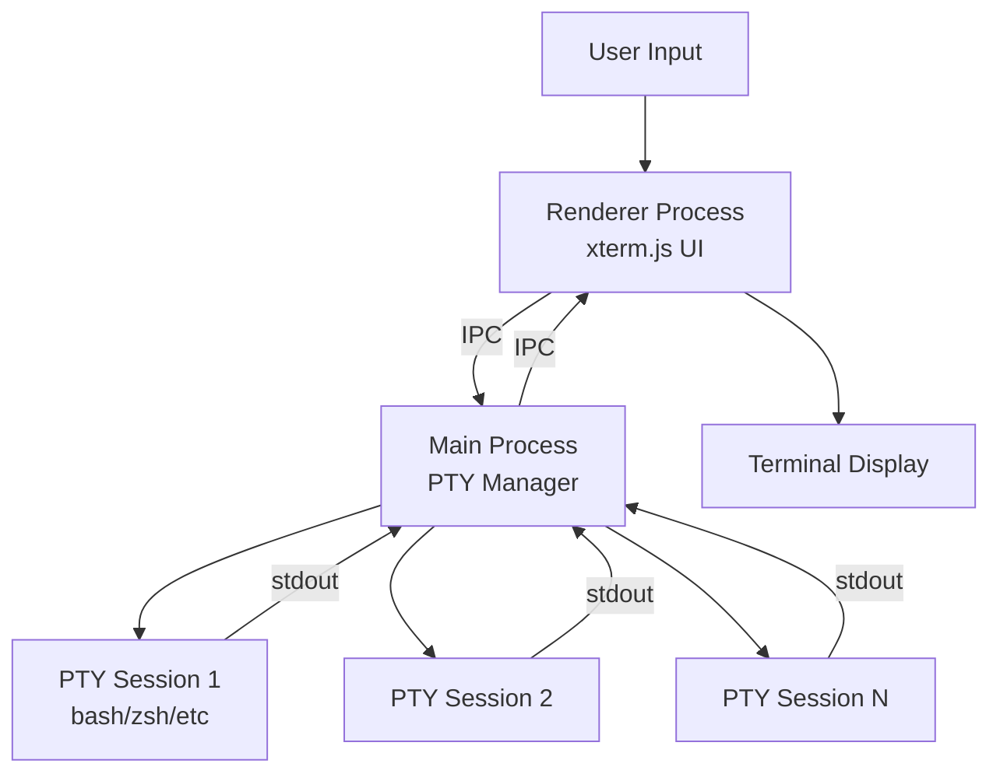
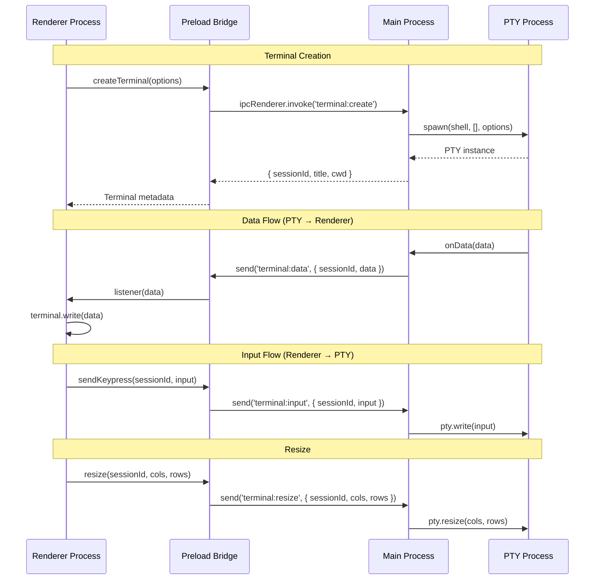
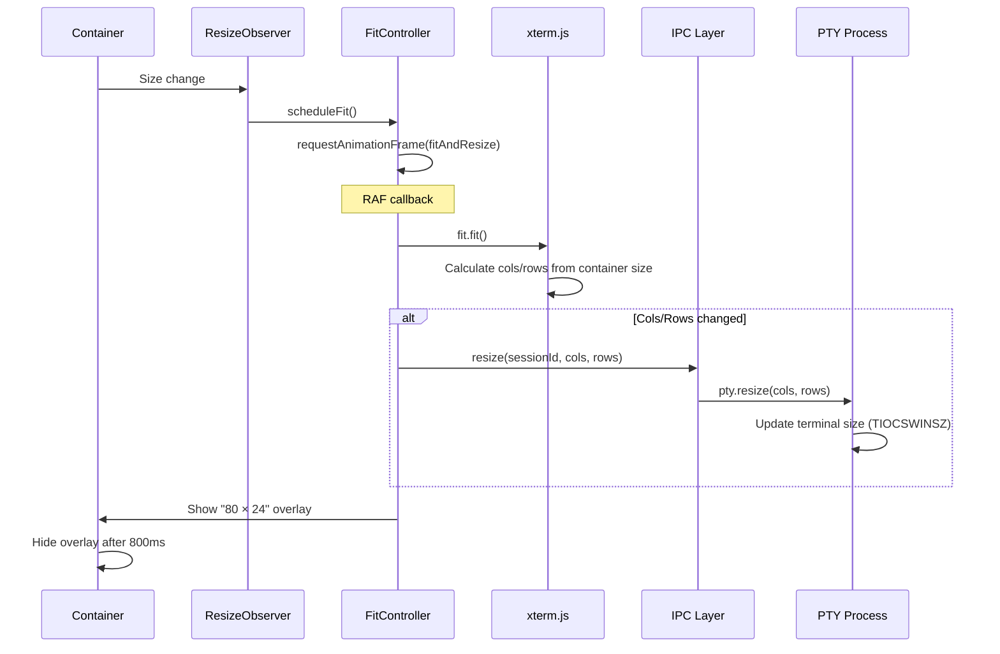
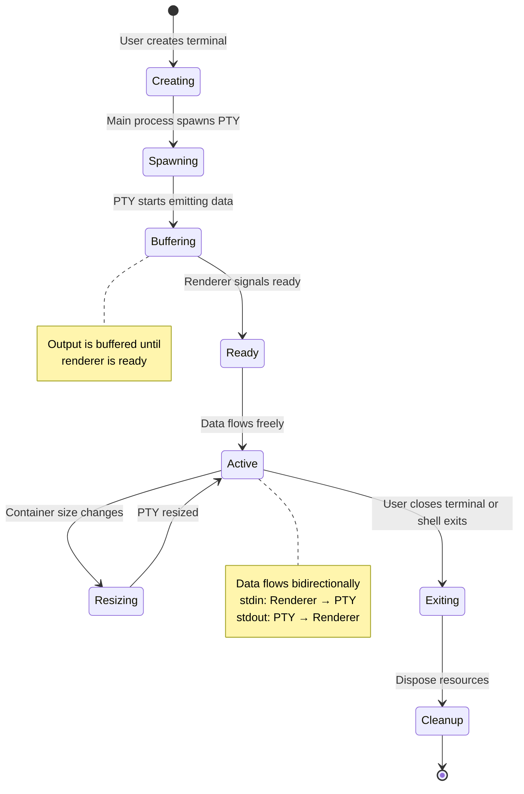
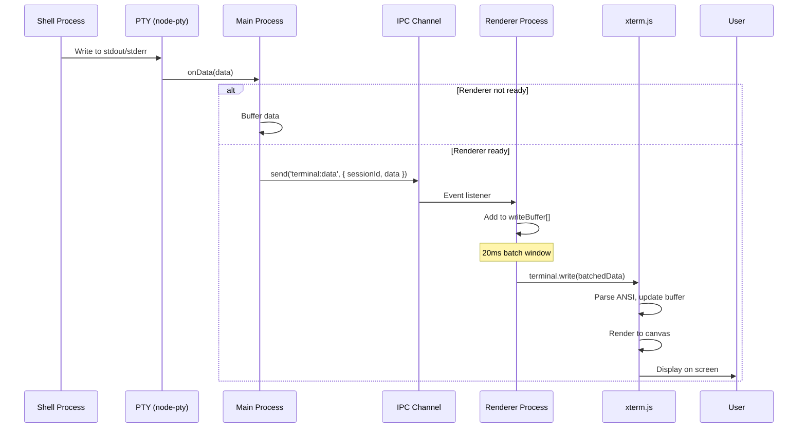
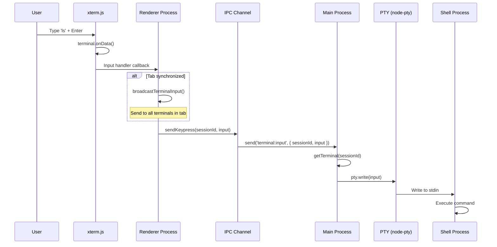

# Conduit Terminal Architecture

This document provides a comprehensive overview of how Conduit terminals are architected, from PTY creation in the main process to rendering in xterm.js, including the IPC communication layer, keyboard handling, search functionality, and resize logic.

## Table of Contents

- [Overview](#overview)
- [Architecture Components](#architecture-components)
- [PTY Creation and Process Management](#pty-creation-and-process-management)
- [IPC Layer and Data Flow](#ipc-layer-and-data-flow)
- [Xterm Cache and Rendering](#xterm-cache-and-rendering)
- [Keyboard Handler](#keyboard-handler)
- [Search Widget](#search-widget)
- [Resize and Fit Logic](#resize-and-fit-logic)
- [Terminal Lifecycle](#terminal-lifecycle)
- [stdin and stdout Flow](#stdin-and-stdout-flow)

## Overview

Conduit terminals are built on a multi-process architecture that leverages Electron's IPC system to separate process management from UI rendering. The architecture consists of:

1. **Main Process (Node.js)** - Spawns and manages PTY processes, handles OS-level I/O
2. **Renderer Process (Browser)** - Renders terminal UI using xterm.js, handles user input
3. **IPC Layer** - Bridges the two processes using Electron's IPC channels

This separation ensures:
- **Security** - Shell processes run in the main process with proper OS-level permissions
- **Performance** - UI rendering happens in the renderer process using browser optimizations
- **Isolation** - Terminal crashes don't affect the main application
- **Scalability** - Multiple terminals can run simultaneously with independent PTY processes



## Architecture Components

### Core Interfaces

```typescript
// Terminal instance in main process
type TerminalInstance = {
  id: string;                    // Unique session identifier
  pty: IPty;                     // node-pty instance
  cwd: string;                   // Current working directory
  lastProcessName: string;       // Active process name
  isRendererReady: boolean;      // UI ready for data
  bufferedOutput: string[];      // Output buffer before UI ready
  cloudEnvironment?: CloudEnvironment;  // VM metadata (if remote)
  
  // CWD tracking state
  oscBuffer: string;
  cwdPoller?: NodeJS.Timeout;
  isPollingCwd: boolean;
  pendingCwdPoll?: NodeJS.Timeout;
  scheduleCwdPoll?: (delay?: number) => void;
  cwdPollFailures: number;
  cwdPollBackedOff: boolean;
};

// Terminal instance in renderer process
type TerminalInstance = {
  terminal: Terminal;            // xterm.js Terminal instance
  fit: FitAddon;                // Fit addon for sizing
  search: SearchAddon;          // Search addon
  serializer: SerializeAddon;   // Serialization addon
  ready: boolean;               // Marked as ready flag
  setLinkHandler: (handler: ((url: string) => void) | null) => void;
  setInputHandler: (handler: ((input: string) => void) | null) => void;
  markReady: () => void;        // Signal ready to main process
  resize: (cols: number, rows: number) => void;  // Resize PTY
  dispose: () => void;          // Cleanup resources
};
```

## PTY Creation and Process Management

Terminal processes are spawned and managed in the main process using the [node-pty](https://github.com/microsoft/node-pty) library, which provides a cross-platform PTY (pseudo-terminal) interface.

### Process Spawning

When a new terminal is created, the main process:

1. Generates a unique session ID (UUID)
2. Resolves the user's shell (bash, zsh, fish, PowerShell, etc.)
3. Builds the terminal environment with Conduit-specific variables
4. Spawns the PTY process
5. Sets up event listeners for data and exit events

**Pseudo code:**

```typescript
function spawnTerminalProcess(sessionId: string, cwd?: string) {
  // Resolve shell based on platform
  const shell = resolveShell();  // $SHELL on Unix, pwsh.exe on Windows
  
  // Build environment with Conduit CLI access
  const env = {
    ...process.env,
    PATH: [cliDirectory, ...currentPath].join(delimiter),
    CONDUIT_SOCKET_PATH: socketPath,      // For CLI IPC
    CONDUIT_SESSION_ID: sessionId,        // Session identifier
    EDITOR: 'conduit',                    // Set as default editor
    VISUAL: 'conduit'
  };
  
  // Spawn PTY with initial dimensions
  return spawn(shell, [], {
    name: 'xterm-256color',
    cols: 80,
    rows: 24,
    cwd: cwd || homeDirectory,
    env
  });
}
```

### Terminal Store

The main process maintains a centralized store of all active terminal sessions:

```typescript
const terminals = new Map<string, TerminalInstance>();

export function storeTerminal(terminal: TerminalInstance) {
  terminals.set(terminal.id, terminal);
}

export function getTerminal(sessionId: string): TerminalInstance | undefined {
  return terminals.get(sessionId);
}

export function removeTerminal(sessionId: string) {
  terminals.delete(sessionId);
}
```

### Event Handling

Once spawned, the PTY emits two critical events:

**Data events (stdout/stderr):**
```typescript
pty.onData((data: string) => {
  if (terminal.isRendererReady) {
    sendToRenderer('terminal:data', { sessionId, data });
  } else {
    // Buffer output until renderer is ready
    terminal.bufferedOutput.push(data);
  }
  
  // Track process name changes
  const processName = pty.process;
  if (processName !== terminal.lastProcessName) {
    terminal.lastProcessName = processName;
    sendToRenderer('terminal:title', { sessionId, title: processName });
  }
});
```

**Exit events:**
```typescript
pty.onExit(({ exitCode, signal }) => {
  // Cleanup resources
  disposeSessionResources(terminal);
  
  // Notify renderer
  sendToRenderer('terminal:exit', {
    sessionId,
    exitCode: exitCode ?? null,
    signal: signal ?? null
  });
  
  // Remove from store after delay
  setTimeout(() => removeTerminal(sessionId), 2000);
});
```

### Process Introspection

Conduit can detect the active foreground command in a terminal using process tree introspection (Unix/Linux/macOS only):

**Algorithm:**
1. Get the PTY's shell process ID
2. Find the TTY device associated with that process
3. List all processes running on that TTY
4. Build a process tree (parent-child relationships)
5. Perform BFS traversal from shell PID
6. Find foreground processes (stat includes '+') that aren't shells
7. Return the first foreground non-shell process

```typescript
async function detectActiveCommand(session: TerminalInstance): Promise<string | null> {
  const shellPid = session.pty.pid;
  const tty = await getTtyForPid(shellPid);
  const processes = await getProcessesForTty(tty);
  
  // BFS to find foreground non-shell process
  const queue = [shellPid];
  while (queue.length > 0) {
    const pid = queue.shift();
    const children = getChildren(processes, pid);
    
    for (const child of children) {
      if (child.stat.includes('+') && !isShellProcess(child.command)) {
        return child.command;  // Found foreground process
      }
      queue.push(child.pid);
    }
  }
  
  return null;
}
```

## IPC Layer and Data Flow

Communication between the main process and renderer process happens through Electron's IPC channels. Conduit uses a bidirectional protocol for terminal operations.

### Channel Architecture



### IPC Handlers (Main Process)

The main process registers handlers for terminal-related IPC events:

```typescript
function initializeTerminalHandlers(sendToRenderer: SendToRendererFn) {
  // Create terminal
  ipcMain.handle('terminal:create', async (_, options) => {
    const terminal = await createTerminal(sendToRenderer, options);
    return {
      sessionId: terminal.id,
      title: terminal.lastProcessName,
      cwd: terminal.cwd,
      vmMetadata: terminal.cloudEnvironment
    };
  });
  
  // Mark renderer ready (enables data flow)
  ipcMain.on('terminal:ready', (_, { sessionId }) => {
    markTerminalReady(sessionId, sendToRenderer);
  });
  
  // Handle user input
  ipcMain.on('terminal:input', (_, { sessionId, input }) => {
    const session = getTerminal(sessionId);
    if (session) {
      session.pty.write(input);
    }
  });
  
  // Handle terminal resize
  ipcMain.on('terminal:resize', (_, { sessionId, cols, rows }) => {
    const session = getTerminal(sessionId);
    if (session) {
      session.pty.resize(
        Math.max(1, Math.floor(cols)),
        Math.max(1, Math.floor(rows))
      );
    }
  });
  
  // Close terminal
  ipcMain.on('terminal:close', (_, { sessionId }) => {
    killTerminal(sessionId);
  });
}
```

### Preload Bridge

The preload script exposes a safe API to the renderer process using `contextBridge`:

```typescript
const conduitAPI = {
  // Create new terminal
  createTerminal: (options) =>
    ipcRenderer.invoke('terminal:create', options),
  
  // Send input to terminal
  sendKeypress: (sessionId, input) =>
    ipcRenderer.send('terminal:input', { sessionId, input }),
  
  // Resize terminal
  resize: (sessionId, cols, rows) =>
    ipcRenderer.send('terminal:resize', { sessionId, cols, rows }),
  
  // Mark terminal ready
  markTerminalReady: (sessionId) =>
    ipcRenderer.send('terminal:ready', { sessionId }),
  
  // Listen for data from PTY
  onData: (sessionId, listener) =>
    createEventListener('terminal:data', (payload) => {
      if (payload.sessionId === sessionId) {
        listener(payload.data);
      }
    }),
  
  // Listen for title changes
  onTitle: (listener) =>
    createEventListener('terminal:title', listener),
  
  // Listen for CWD changes
  onCwd: (listener) =>
    createEventListener('terminal:cwd', listener),
  
  // Listen for terminal exit
  onExit: (listener) =>
    createEventListener('terminal:exit', listener)
};

contextBridge.exposeInMainWorld('conduit', conduitAPI);
```

### Data Buffering

Before the renderer is ready to display content, the main process buffers PTY output:

```typescript
function setupTerminalListeners(terminal: TerminalInstance, sendToRenderer) {
  terminal.pty.onData((data) => {
    if (terminal.isRendererReady) {
      // Renderer is ready, send immediately
      sendToRenderer('terminal:data', { sessionId: terminal.id, data });
    } else {
      // Buffer until ready
      terminal.bufferedOutput.push(data);
    }
  });
}

function markTerminalReady(sessionId: string, sendToRenderer) {
  const terminal = getTerminal(sessionId);
  if (!terminal) return;
  
  terminal.isRendererReady = true;
  
  // Flush buffered output
  terminal.bufferedOutput.forEach(data =>
    sendToRenderer('terminal:data', { sessionId: terminal.id, data })
  );
  terminal.bufferedOutput = [];
}
```

## Xterm Cache and Rendering

The renderer process uses [xterm.js](https://github.com/xtermjs/xterm.js) for terminal rendering. Conduit maintains a cache of xterm instances to enable terminal persistence across pane operations.

### Terminal Instance Cache

```typescript
const store = new Map<string, TerminalInstance>();

function getOrCreate(sessionId: string): TerminalInstance {
  let instance = store.get(sessionId);
  
  if (!instance) {
    // Create new xterm.js instance
    const terminal = new Terminal({
      fontFamily: '"Fira Code", Menlo, Monaco, "Courier New", monospace',
      fontSize: 13,
      cursorBlink: true,
      scrollback: 2000,
      allowProposedApi: true,  // For decorations API
      theme: {
        background: resolveColor('background'),
        foreground: resolveColor('foreground'),
        cursor: resolveColor('foreground'),
        selectionBackground: resolveColor('selection')
      }
    });
    
    // Load addons
    const fit = new FitAddon();
    const search = new SearchAddon();
    const serializer = new SerializeAddon();
    const webLinks = new WebLinksAddon((_, uri) => {
      api.openExternal(uri);
    });
    
    terminal.loadAddon(fit);
    terminal.loadAddon(search);
    terminal.loadAddon(webLinks);
    terminal.loadAddon(serializer);
    
    instance = { terminal, fit, search, serializer, ready: false, ... };
    store.set(sessionId, instance);
  }
  
  return instance;
}
```

### Data Batching

To prevent cursor flicker in TUI applications, incoming data is batched before rendering:

```typescript
let writeBuffer: string[] = [];
let flushTimer: NodeJS.Timeout | null = null;

const flushWrites = () => {
  if (writeBuffer.length > 0) {
    terminal.write(writeBuffer.join(''));
    writeBuffer = [];
  }
  flushTimer = null;
};

api.onData(sessionId, (data: string) => {
  writeBuffer.push(data);
  if (flushTimer === null) {
    flushTimer = setTimeout(flushWrites, 20);  // 20ms batch window
  }
});
```

### Input Handling

User input flows from xterm.js back to the PTY through IPC:

```typescript
terminal.onData((input) => {
  api.sendKeypress(sessionId, input);
  inputHandler?.(input);  // Optional synchronized input
});
```

### Attachment and Detachment

Terminal DOM elements can be moved between containers without losing state:

```typescript
function attach(sessionId: string, container: HTMLElement) {
  const instance = store.get(sessionId);
  if (!instance) return;
  
  const element = instance.terminal.element;
  if (element && element.parentElement !== container) {
    // Move existing DOM element
    container.appendChild(element);
  } else {
    // Initial mount
    instance.terminal.open(container);
  }
}
```

## Keyboard Handler

Conduit implements a custom keyboard event handler that intercepts specific key combinations before they reach the shell.

### Handler Registration

```typescript
function registerTerminalKeyHandler({
  entry,
  terminalId,
  showSearchWidget,
  togglePromptMode,
  getApplicationMode,
  setNormalMode,
  onSynchronizedInput
}) {
  const keyHandler = (event: KeyboardEvent) => {
    if (event.type !== 'keydown') return true;
    
    const isCtrlOrMeta = event.ctrlKey || event.metaKey;
    
    // Handle specific key combinations
    // Return false to prevent default handling
    // Return true to let xterm.js handle it
  };
  
  entry.terminal.attachCustomKeyEventHandler(keyHandler);
  
  return () => {
    // Detach is automatic on next attach
  };
}
```

### Key Bindings

| Key Combination | Action | Behavior |
|----------------|--------|----------|
| `Ctrl/Cmd + F` | Search | Opens search widget |
| `Ctrl/Cmd + P` | Prompt | Opens AI prompt overlay |
| `Ctrl/Cmd + C` | Copy/Interrupt | Copies if selection exists, otherwise sends SIGINT |
| `Escape` | Exit mode | Exits focus/overview mode if active, otherwise sends to terminal |

**Search trigger (Ctrl/Cmd + F):**
```typescript
if (isCtrlOrMeta && !event.shiftKey && !event.altKey && event.key.toLowerCase() === 'f') {
  showSearchWidget();
  return false;  // Prevent default
}
```

**Copy vs Interrupt (Ctrl/Cmd + C):**
```typescript
if (isCtrlOrMeta && !event.shiftKey && !event.altKey && event.key.toLowerCase() === 'c') {
  if (terminal.hasSelection()) {
    return true;  // Let xterm.js handle copy
  }
  
  // No selection, send SIGINT
  api.sendKeypress(terminalId, '\u0003');
  onSynchronizedInput?.('\u0003');
  return false;
}
```

**Escape key handling:**
```typescript
if (!isCtrlOrMeta && event.key === 'Escape') {
  const mode = getApplicationMode();
  
  if (mode === 'focus') {
    event.preventDefault();
    exitFocusMode();
    return false;
  }
  
  if (mode === 'overview') {
    event.preventDefault();
    setNormalMode();
    return false;
  }
  
  // Normal mode - send escape and broadcast if synchronized
  onSynchronizedInput?.('\x1b');
}
```

### Synchronized Input

When tab synchronization is enabled, input is broadcast to all terminals in the tab:

```typescript
const handleSynchronizedInput = (input: string) => {
  if (!isActive) return;
  
  // Broadcast to all other terminals in the same tab
  broadcastTerminalInput(paneId, input);
};

// Register with handler
entry.setInputHandler(
  isTabSynchronized ? handleSynchronizedInput : null
);
```

## Search Widget

The search widget provides a floating search UI with regex support, case sensitivity, and whole word matching.

### Widget Interface

```typescript
type SearchWidgetHandle = {
  show: (selection: string) => void;
};

type SearchResults = {
  index: number;   // Current match index (-1 if none)
  count: number;   // Total number of matches
};
```

### Search Implementation

The widget uses xterm.js's SearchAddon with custom decorations:

```typescript
function buildSearchOptions(): ISearchOptions {
  return {
    caseSensitive: matchCase,
    wholeWord: matchWholeWord,
    regex: useRegex,
    decorations: {
      matchBackground: resolveColor('selection'),
      matchOverviewRuler: resolveColor('selection'),
      activeMatchBackground: resolveColor('accent'),
      activeMatchColorOverviewRuler: resolveColor('accent')
    }
  };
}
```

### Incremental Search

As the user types, search results update in real-time:

```typescript
function updateSearchTerm(value: string) {
  setSearchTerm(value);
  
  const trimmed = value.trim();
  if (!trimmed) {
    clearSearchArtifacts();
    return;
  }
  
  // Perform incremental search
  searchAddon.findNext(trimmed, {
    ...buildSearchOptions(),
    incremental: true
  });
}
```

### Navigation

Users can navigate between matches using arrow buttons or Enter key:

```typescript
function runSearch(direction: 'next' | 'previous') {
  const trimmed = searchTerm.trim();
  if (!searchAddon || !trimmed) return;
  
  if (direction === 'next') {
    searchAddon.findNext(trimmed, buildSearchOptions());
  } else {
    searchAddon.findPrevious(trimmed, buildSearchOptions());
  }
}

// Keyboard navigation
function handleSearchKeyDown(event: KeyboardEvent) {
  if (event.key === 'Enter') {
    event.preventDefault();
    runSearch(event.shiftKey ? 'previous' : 'next');
  }
}
```

### Result Tracking

The widget displays the current match position:

```typescript
searchAddon.onDidChangeResults(({ resultIndex, resultCount }) => {
  setSearchResults({ index: resultIndex, count: resultCount });
});

// Display: "5 of 23" or "No results"
const searchStatusLabel = 
  resultCount <= 0 ? 'No results' :
  resultIndex >= 0 ? `${resultIndex + 1} of ${resultCount}` :
  `${resultCount} results`;
```

## Resize and Fit Logic

Terminal resizing is handled by a fit controller that observes container size changes and updates both the xterm.js instance and the underlying PTY.

### Fit Controller

The fit controller uses ResizeObserver to detect size changes and RAF (RequestAnimationFrame) to batch resize operations:

```typescript
function createFitController({ entry, container, setDimensions }) {
  let lastContainerSize = { width: 0, height: 0 };
  let lastTerminalSize = { cols: entry.terminal.cols, rows: entry.terminal.rows };
  let fitTimeout: number | null = null;
  
  function fitAndResize() {
    const width = container.clientWidth;
    const height = container.clientHeight;
    
    // Skip if container has no size
    if (width === 0 || height === 0) return;
    
    // Show overlay if container size changed
    if (width !== lastContainerSize.width || height !== lastContainerSize.height) {
      lastContainerSize = { width, height };
      showDimensionsOverlay(width, height);
    }
    
    // Fit terminal to container
    entry.fit.fit();
    
    // Resize PTY if cols/rows changed
    const cols = entry.terminal.cols;
    const rows = entry.terminal.rows;
    if (cols !== lastTerminalSize.cols || rows !== lastTerminalSize.rows) {
      lastTerminalSize = { cols, rows };
      entry.resize(cols, rows);  // Calls IPC to resize PTY
    }
    
    // Mark ready after first fit
    if (!entry.ready) {
      entry.markReady();
    }
  }
  
  function scheduleFit() {
    if (fitTimeout !== null) {
      cancelAnimationFrame(fitTimeout);
    }
    fitTimeout = requestAnimationFrame(fitAndResize);
  }
  
  // Observe container size changes
  const observer = new ResizeObserver(scheduleFit);
  observer.observe(container);
  
  // Initial fit
  scheduleFit();
  
  return {
    dispose: () => {
      if (fitTimeout !== null) {
        cancelAnimationFrame(fitTimeout);
      }
      observer.disconnect();
    }
  };
}
```

### Resize Flow



### Dimensions Overlay

When the terminal is resized, a temporary overlay shows the new dimensions (cols × rows):

```typescript
function showDimensionsOverlay(width: number, height: number) {
  setDimensions({ width, height });
  
  clearTimeout(overlayTimeout);
  overlayTimeout = setTimeout(() => {
    setDimensions(null);
  }, 800);  // Hide after 800ms
}
```

## Terminal Lifecycle

The terminal lifecycle encompasses creation, readiness signaling, data flow, and cleanup.

### Complete Lifecycle



### Step-by-Step Lifecycle

**1. React renders `<TerminalPane/>`**

```typescript
const TerminalPane = ({ terminalId, isActive, paneId }) => {
  const containerRef = useRef<HTMLDivElement>(null);
  
  useEffect(() => {
    const container = containerRef.current;
    if (!container) return;
    
    // Get or create xterm instance
    const terminal = getOrCreate(terminalId);
    
    // ... (see next steps)
  }, [terminalId]);
};
```

**2. Get or create xterm.js instance**

```typescript
// Reuse existing instance or create new one
const entry = getOrCreate(terminalId);

// Configure terminal
entry.terminal.options.fontSize = fontSize ?? 13;
```

**3. Attach terminal DOM to container**

```typescript
attach(terminalId, container);
// Either moves existing DOM element or calls terminal.open(container)
```

**4. Create fit controller**

```typescript
const controller = createFitController({
  container,
  entry,
  setDimensions
});
// Sets up ResizeObserver, schedules initial fit
```

**5. First fit triggers readiness**

```typescript
function fitAndResize() {
  entry.fit.fit();
  
  // ... handle resize
  
  if (!entry.ready) {
    entry.markReady();  // Signals main process via IPC
  }
}
```

**6. Main process flushes buffered output**

```typescript
function markTerminalReady(sessionId: string, sendToRenderer) {
  const terminal = getTerminal(sessionId);
  terminal.isRendererReady = true;
  
  // Send all buffered output
  terminal.bufferedOutput.forEach(data =>
    sendToRenderer('terminal:data', { sessionId: terminal.id, data })
  );
  terminal.bufferedOutput = [];
}
```

**7. Terminal enters active state**

- User input flows: Renderer → IPC → Main → PTY
- PTY output flows: PTY → Main → IPC → Renderer
- Resize events update both xterm.js and PTY

**8. Cleanup on unmount**

```typescript
return () => {
  controller.dispose();           // Stop ResizeObserver
  detachKeyHandler();            // Remove keyboard handler
  terminal.setInputHandler(null); // Clear input handler
  
  // Note: Terminal instance remains in cache for potential reuse
};
```

## stdin and stdout Flow

Data flows bidirectionally between the user, renderer process, IPC layer, main process, and PTY.

### stdout Flow (PTY → User)



**Process details:**

1. **Shell writes output** - Commands like `echo`, `ls`, `git` write to stdout/stderr
2. **PTY captures output** - node-pty intercepts the output stream
3. **Main process handles data event** - `pty.onData()` callback fires
4. **Buffering (if needed)** - If renderer isn't ready, data is buffered
5. **IPC transmission** - Data sent via `terminal:data` channel with sessionId
6. **Renderer receives data** - Event listener filters by sessionId
7. **Batching** - Data accumulated in buffer for 20ms to reduce flicker
8. **xterm.js processing** - Terminal parses ANSI codes, updates internal buffer
9. **Rendering** - Canvas-based rendering displays the output

### stdin Flow (User → PTY)



**Process details:**

1. **User types** - Keyboard input captured by browser
2. **xterm.js processes** - `terminal.onData()` fires with input characters
3. **Custom handler (optional)** - Tab synchronization broadcasts to other terminals
4. **IPC call** - `sendKeypress(sessionId, input)` sends via `terminal:input` channel
5. **Main process routes** - Looks up terminal session by ID
6. **PTY write** - `pty.write(input)` sends to shell's stdin
7. **Shell processes** - Command is executed, output goes to stdout

### Special Characters

Certain key combinations produce control characters:

| Key | Character | Hex | Purpose |
|-----|-----------|-----|---------|
| Ctrl+C | ETX | `\u0003` | SIGINT (interrupt) |
| Ctrl+D | EOT | `\u0004` | EOF (end of input) |
| Ctrl+Z | SUB | `\u001A` | SIGTSTP (suspend) |
| Escape | ESC | `\x1b` | Escape sequences |
| Enter | LF | `\r` | Line feed |
| Backspace | BS | `\u007F` | Delete character |

### ANSI Escape Sequences

Output from the PTY includes ANSI escape sequences for:

- **Colors** - `\x1b[31m` (red), `\x1b[32m` (green), etc.
- **Cursor movement** - `\x1b[H` (home), `\x1b[2J` (clear screen)
- **Text formatting** - `\x1b[1m` (bold), `\x1b[4m` (underline)
- **OSC sequences** - `\x1b]633;P;Cwd=...` (directory changes)

xterm.js parses these sequences and updates its internal buffer and rendering accordingly.

### CWD Tracking

Conduit tracks the current working directory using OSC (Operating System Command) sequences:

```typescript
function consumeOscSequences(terminal: TerminalInstance, data: string, sendToRenderer) {
  terminal.oscBuffer += data;
  
  // Look for OSC 633 sequences (VSCode shell integration)
  const cwdMatch = terminal.oscBuffer.match(/\x1b\]633;P;Cwd=([^\x07\x1b]*)/);
  
  if (cwdMatch) {
    const rawCwd = cwdMatch[1];
    const cwd = decodeURIComponent(rawCwd);
    
    if (cwd !== terminal.cwd) {
      terminal.cwd = cwd;
      sendToRenderer('terminal:cwd', { sessionId: terminal.id, cwd });
    }
    
    terminal.oscBuffer = '';
  }
}
```

**Fallback polling:**

If the shell doesn't emit OSC sequences, Conduit polls the CWD:

```typescript
function startCwdPolling(terminal: TerminalInstance, sendToRenderer) {
  const pollCwd = async () => {
    const cwd = await readPtyCwd(terminal.pty.pid);
    if (cwd && cwd !== terminal.cwd) {
      terminal.cwd = cwd;
      sendToRenderer('terminal:cwd', { sessionId: terminal.id, cwd });
    }
  };
  
  terminal.cwdPoller = setInterval(pollCwd, 1000);  // Poll every second
}
```

---

This comprehensive overview covers the major aspects of Conduit's terminal architecture. For more details on specific components, refer to the source files:

- PTY Management: `src/ipc/terminal/pty.ts`, `src/ipc/terminal/store/actions.ts`
- IPC Layer: `src/ipc/terminal/index.ts`, `src/preload/index.ts`
- Rendering: `src/renderer/components/panes/terminal/TerminalPane.tsx`
- xterm Cache: `src/renderer/components/panes/terminal/xtermCache.ts`
- Fit Controller: `src/renderer/components/panes/terminal/FitController.ts`
- Search Widget: `src/renderer/components/panes/terminal/SearchWidget.tsx`
